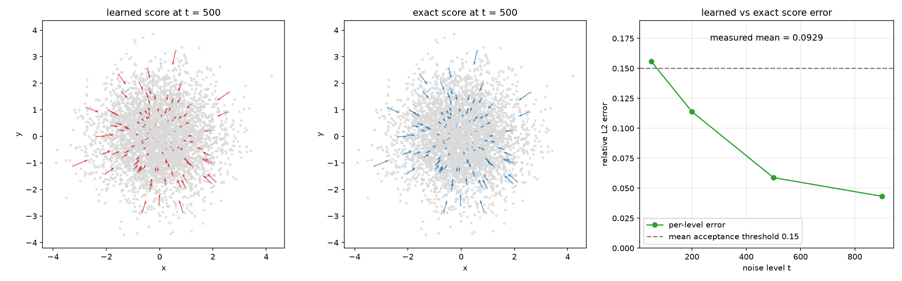
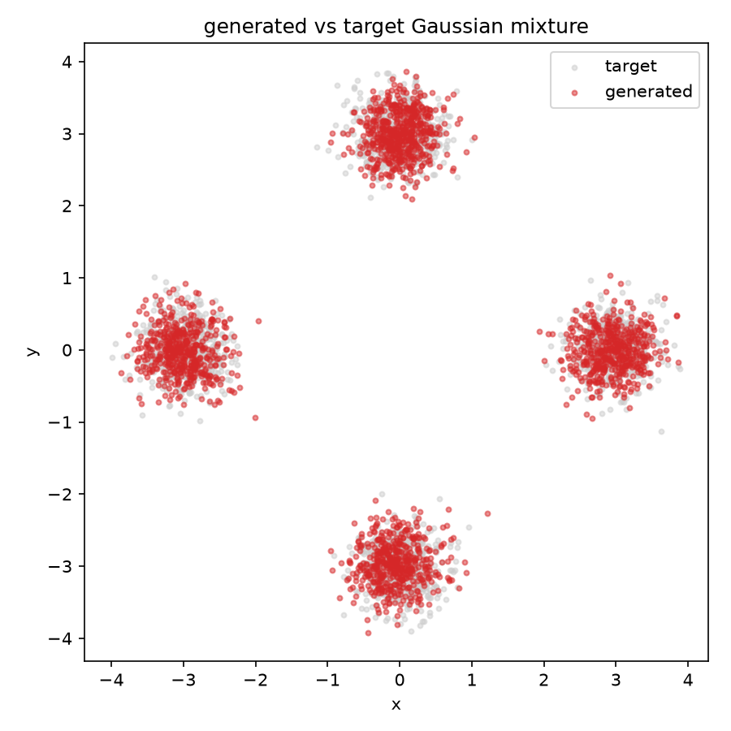

# Week 6 — Diffusion models

This documents **Part 1 only**: learning the score of a two-dimensional Gaussian
mixture. Later parts are deliberately not started yet.

## Setup

```bash
cd week6
uv sync
```

`uv` was installed with the official installer
(`curl -LsSf https://astral.sh/uv/install.sh | sh`). JAX runs on CPU.

## Files

- `SPEC.md` — Part 1 task specification and acceptance criteria
- `ddm.py` — schedule, forward noising, exact mixture score, noise predictor,
  DDPM reverse step and sampling
- `test_ddm.py` — mathematical tests for the exact score, noising, and reverse
  update
- `scripts/train_p1.py` — train the noise predictor
- `scripts/evaluate_p1.py` — generate samples, compare scores, draw evidence
- `scripts/verify_p1.py` — independently check persisted run settings and acceptance
- `evidence/` — figures
- `artifacts/p1/` — raw run outputs (git-ignored)

## Commands and measured values

### Mathematical tests

```bash
uv run pytest -q
```

Result after independent review: `9 passed`, including a fixed-key reverse-noise
reference and a negative control that detects omitted reverse noise.

### Training

```bash
uv run python scripts/train_p1.py
```

Config: seed `2026`, 25000 updates, batch 512, uniform levels `1..1000`, MSE
noise-prediction loss, MLP `2+64 -> 256 -> 256 -> 256 -> 256 -> 2` with SiLU,
Adam `lr=1e-3`. Target: four Gaussians centred `(3,0),(0,3),(-3,0),(0,-3)`,
covariance `0.09 I`. Schedule: `beta = linspace(1e-4, 0.02, 1000)`.

Measured: final loss `0.254224`, wall time `154.4 s`.

### Sampling and evaluation

```bash
uv run python scripts/evaluate_p1.py
```

Writes `artifacts/p1/samples.npz` (2000 samples, 1000-step DDPM, seed 2026, no
clipping), `artifacts/p1/target-samples.npz`, score errors, measurements, and
the two evidence figures.

Score check (4096 fresh noised samples per level; relative L2 error =
`||learned - exact||_2 / ||exact||_2`):

| level t | relative L2 error |
|--------:|------------------:|
| 50      | 0.155761          |
| 200     | 0.113819          |
| 500     | 0.058819          |
| 900     | 0.043249          |
| mean    | **0.092912**      |

Mean `0.092912 < 0.15`, so the acceptance check passes.

Sample check: all 2000 generated points lie within radius 1.5 of one of the four
centres (100%), matching the target's 100%. Counts within radius 1.5 by centre:

| centre   | generated | target |
|----------|----------:|-------:|
| (3, 0)   | 489       | 463    |
| (0, 3)   | 554       | 550    |
| (-3, 0)  | 479       | 495    |
| (0, -3)  | 478       | 492    |

### Evidence figures

`evidence/score.png` is produced by `scripts/evaluate_p1.py`:

- learned-score quiver and exact-score quiver at `t = 500` over the noised
  samples (120 shared subsampled arrows per field, with identical axes and scale),
- relative L2 error against noise level, with the 0.15 acceptance limit.

`evidence/mixture.png` is produced by `scripts/evaluate_p1.py`:

- overlay of 2000 generated samples and 2000 fresh target samples with equal
  axis scales.

## Commit history for this work

```text
3b01cb7 week6: specify Part 1 diffusion score task and Python environment
393c3ae week6: define Part 1 mathematical tests that fail without ddm module
f60c1ba week6: implement Part 1 diffusion math and pass mathematical tests
74b8529 week6: add Part 1 training and evaluation scripts
```

## Notes

- `artifacts/`, `runs/`, and `inputs/` are git-ignored.
- No answer-key reference numbers were used as results; all values above were
  measured from this repository's own run.
- Generated samples use no clipping because the mixture extends beyond `[-1, 1]`.

## Reviewed evidence and independent verification

```bash
uv run python scripts/evaluate_p1.py
uv run python scripts/verify_p1.py
uv run pytest -q
```





The dashed score line is the **mean** acceptance threshold, not a requirement
that every individual level be below 0.15. At t=50 the error is 0.155761;
the four-level mean is 0.092912 and passes the prescribed check. The mode
counts, radius-1.5 coverage and coordinate ranges are persisted in
`artifacts/p1/measurements.json`, rather than inferred from the plot.

Independent verification after review: 9 tests passed; the standalone
verifier passed; all loss step numbers 1..25000 were present, all losses
were finite, and the saved samples had shape (2000,2). The learned and
exact score arrows at t=500 point towards greater probability near the
centre of the heavily noised distribution. Generated samples recover all
four clean-data modes with a similar spread to fresh target samples.

## Execution status

Part 1 was implemented and trained through native Linux pi in WSL, using the
human-authorized `volcengine-plan` provider. An independent Codex review
requested readable quiver scales and meaningful reverse-noise tests; pi
implemented those corrections and a standalone verifier. The provider then
returned `429 AccountQuotaExceeded`, reporting a reset at
2026-10-13 20:48:31 Asia/Shanghai. Codex completed the mechanical documentation
and verification handoff. Parts 2-5 have not started. No cloud resources
were created and this work has not been pushed.
