# Week 6 — Energy-based models: Parts 1–4

AMAT5315 Scientific Computing for Physicists, Week 6 learning sheet
("Energy-based models", retrieved 2026-10-14; PDF SHA256
`fa80cc242513d2c513b5048ea39369406f842488ac1837ca404c6b3ea210be8f`).
This folder implements the complete Week 6 exercise, Parts 1–4
(Part 1: dataset understanding; Part 2: RBM with CD; Part 3: classical
Hopfield capacity; Part 4: modern Hopfield / attention). See `SPEC.md`
for each part's scope and acceptance criteria. Source identity: see
`SOURCE.md`. Parent `week6/` diffusion work is separate and untouched.

## Environment

```bash
uv sync            # numpy, matplotlib, jax[cpu], pytest (CPU baseline)
uv run pytest -q   # 50 tests
```

## Data provenance

Original files, no substitutes. Requested URLs and sizes/SHA-256 hashes are
in `evidence/provenance.json` (generated by `scripts/provenance.py`; the
effective URL is re-observed by a HEAD probe there, not invented). Fetched
2026-10-14.

| Dataset | Requested URL | Files |
|---|---|---|
| MNIST | `https://storage.googleapis.com/cvdf-datasets/mnist` | `{train,t10k}-{images-idx3-ubyte,labels-idx1-ubyte}.gz` |
| CIFAR-10 | `https://cave.cs.toronto.edu/kriz/cifar-10-binary.tar.gz` | `cifar-10-binary.tar.gz` |

Downloads live in `inputs/` (git-ignored) and are kept for later parts.

## Loaders

`src/ebm/data.py` validates IDX magic numbers (2051 images / 2049 labels),
counts, dimensions, uint8 range and image↔label pairing; CIFAR-10 records
are validated as 3073 bytes = 1 label + 1024 R + 1024 G + 1024 B, with the
RGB plane order checked by tests (a swapped-channel negative control fails
detection if the loader is wrong). The CIFAR tarball is read member-by-member
in memory — no archive extraction to disk.

## Evidence

Part 1 figures are regenerated by the following command and live in `evidence/`:

```bash
uv run python scripts/make_evidence.py   # galleries + frequency plots + summary JSON
uv run python scripts/provenance.py      # provenance.json
```

Gallery selection is deterministic to avoid cherry-picking: the **first 5
stored examples per class, in stored dataset order**, separately for each
split. Frequency plots use **all** labels of each split.

| Figure | Command | File |
|---|---|---|
| MNIST train gallery (native 28×28, nearest) | `make_evidence.py` | `evidence/mnist_train_gallery.png` |
| MNIST test gallery | `make_evidence.py` | `evidence/mnist_test_gallery.png` |
| MNIST train / test class frequencies | `make_evidence.py` | `evidence/mnist_{train,test}_frequencies.png` |
| CIFAR-10 train / test galleries (native 32×32 RGB) | `make_evidence.py` | `evidence/cifar10_{train,test}_gallery.png` |
| CIFAR-10 train / test class frequencies | `make_evidence.py` | `evidence/cifar10_{train,test}_frequencies.png` |
| Counts and fractions | `make_evidence.py` | `evidence/part1_summary.json` |

## Verification results (real data)

- **MNIST**: 60 000 train / 10 000 test images, 28×28 grayscale, uint8
  0–255, original split assignments preserved. Digit **1 is the most common**
  and digit **5 the least common** class in both splits (see
  `part1_summary.json` and the frequency plots).
- **CIFAR-10**: 50 000 train / 10 000 test images, 32×32 RGB, **exactly
  5 000 train / 1 000 test images per class**, so every plotted fraction is
  0.1.

## What the figures mean

**Empirical distribution vs unknown population.** Each dataset is a finite
sample from an unknown probability distribution over images. The empirical
distribution places probability 1/N on each of its N records; the class
frequency p̂(y=c) = (1/N) Σₙ 1[y₍ₙ₎=c] (sheet eq. 2) is therefore a *measured
fraction of this particular dataset*, not the unknown population probability.
Another sample of handwritten digits would give slightly different fractions;
the MNIST imbalance (digit 1 common, digit 5 rare) is a property that
persisted across both independent splits here, which suggests it reflects the
collection process rather than sampling noise.

**Gallery appearance vs frequency.** The galleries show one balanced block of
examples per class, chosen deterministically as the first stored examples, so
you can compare *what each class looks like* — stroke variety in MNIST
handwriting, object pose and background in CIFAR-10 photographs. Showing an
equal number of images per class is a display choice: it helps appearance
comparison but **hides unequal frequencies**. A balanced gallery does not
imply a balanced dataset — that is exactly why the frequency plots exist, and
why they count every label rather than displayed ones.

**Image representation.** MNIST stores one brightness value per pixel
(grayscale, 28×28, integers 0–255); enlarging a gallery makes pixels easier to
see but adds no information, so figures render native pixels with
nearest-neighbour (no) interpolation. CIFAR-10 stores three values per pixel
(RGB, 32×32, 0–255); at this resolution fine object details are lost, which
the 32×32 galleries make visible.

**Splits and source identity.** The training split is reserved for fitting
models in later parts; the test split is held out for evaluation. Both were
downloaded as the original author-defined files (CVDF mirror of MNIST; the
CIFAR-10 authors' binary archive), preserving the original train/test
assignment — we never reshuffle records across splits.

## Part 2 reference settings (as implemented)

RBM/CD settings from the sheet: 128 hidden units, 20 epochs, batch size 100,
plain gradient descent with learning rate 0.1, seed 2026, matched
initialization and data permutations for CD-1 vs CD-10 (see the Part 2
section below for results).
---

# Part 2 — RBM: CD learning, fresh generation, clamped completion

## Model and training (exact settings, recorded before the run)

Binarized MNIST at half intensity (`v_i = 1` iff pixel >= 128; spins
`s_i = 2v_i - 1`), energy `E(v,h) = -a.v - b.h - vWh`, visible free energy
`F(v) = -a.v - sum_j softplus(b_j + (vW)_j)` (sheet eqs. 3-4). Training:
128 hidden units, 20 epochs, batch 100, plain SGD lr 0.1, seed 2026, CD-1
and CD-10 with **exactly shared initial parameters and per-epoch data
permutations** (SHA-256 hashes in `artifacts/part2/shared_hashes.json`;
per-model *stochastic step-key streams* differ by construction, formula
`split(split(PRNGKey(2026))[0] folded in with k, 21)`). Visible bias from
the logit of TRAIN pixel means clipped to [1e-3, 1-1e-3] (finite logits,
no held-out data used); hidden bias 0; W ~ N(0, 0.01^2). Epoch loop is one
JIT-compiled `lax.scan` over 600 minibatches; a Python loop over epochs logs
metrics. The CD surrogate is `mean[F(v0) - F(stop_gradient(vk))]` with chain
starts at each training batch (no persistent CD). Full 60000 images, 20
epochs; test split only for evaluation.

```bash
uv run python scripts/part2_train.py        # ~50s (CD-1) + ~295s (CD-10), CPU
uv run python scripts/part2_verify2.py      # learning-curve figure
uv run python scripts/part2_verify134.py    # VERIFY 1/3/4 figures + raw dumps
```

## VERIFY2 — learning curves (`evidence/part2_learning_curves.png`)

Held-out one-step reconstruction Hamming fraction on all 10000 test images,
including initialization: **CD-1 0.1721574 -> 0.0477611** (ratio 0.277), **CD-10
0.1724936 -> 0.0491879** (ratio 0.285); both far below the acceptance threshold
final < 0.5 x initial. Actual runtimes: CD-1 50.0 s, CD-10 294.5 s
(local CPU). The CD surrogate does not decrease monotonically — it is
not the NLL; differentiating the free-energy difference with sampled
endpoints fixed gives the CD update (sheet eq. 9-10), and exact NLL would
need the infeasible log Z of 2^784 configurations, so no NLL claim is made.

## VERIFY1 — representation (`part2_binarized_first16.png`,
`part2_spin_configuration.png`, `part2_rbm_diagram.png`)

First 16 binarized training images (native pixels), one enlarged spin
configuration (+1 ink / -1 background), and the RBM diagram: 784 visible and
128 hidden bits, every learned coupling joining one visible bit to one
hidden bit, no within-layer edges.

## VERIFY3 — reconstruction vs fresh generation
(`part2_reconstructions_first16.png`, `part2_generation_cd1.png`,
`part2_generation_cd10.png`, `part2_generation_trajectories.png`)

One-step reconstructions of the first 16 held-out digits are recognizable
for both models. Fresh generation starts from 16 Bernoulli(0.5) random
configurations — the SAME starts across the two models, each chain with its
OWN start — evolved with fixed parameters for 1, 10, 100 and 1000 steps.
After 1 step the chains retain speckle; by 100-1000 steps connected
stroke-like blobs and rings appear. Honest reading: mostly blob/ring shapes
rather than clean digits — as the sheet says for a model this small trained
this briefly. Chains sometimes revisit similar shapes; one-step
reconstruction quality is NOT evidence of good fresh sampling, because the
reconstruction chain merely starts near a digit.

## VERIFY4 — completion as inference (`part2_completion_curves.png`,
`part2_completion_cd1.png`, `part2_completion_cd10.png`,
`evidence/part2_completion_metrics.json`)

Lower 14 rows (392 bits) of the first 64 held-out digits are completed by
clamped block Gibbs sampling (upper half reset after every sweep — the
production `clamped_gibbs_chain`, clamp invariance asserted on every
snapshot): 8 chains per digit, matched random missing-bit starts across
models and conditions, snapshots at 1/10/100/1000 steps. The wrong-upper
control uses the first cyclic different-label held-out digit (full mapping
and labels in the metrics JSON, fixed before any outcome). Ink Dice on the
missing half (2|A∩B|/(|A|+|B|), blank -> 0 including both-blank): chains
averaged within each digit, then mean ± SEM over the 64 digits.

| model | true upper @1000 | wrong upper @1000 | difference | >= 0.1 |
|---|---|---|---|---|
| CD-1  | 0.435 ± 0.016 | 0.244 | **0.191** | pass |
| CD-10 | 0.522 ± 0.019 | 0.250 | **0.272** | pass |

These sit close to the sheet's reference (CD-10 0.51±0.02 vs 0.27; CD-1
0.40±0.02 vs 0.24). Wrong-upper overlap stays flat near 0.25: different
digits share strokes near the image center. Clamping turns generation into
*inference*: with parameters fixed, the clamped chain's missing bits have
p(v_M | v_O) as their stationary distribution.

## Limitations

- The CD surrogate is a training diagnostic only; no NLL/AIS was computed.
- Fresh generation produces blobs/strokes, rarely clean digits; neither
  longer CD chains nor longer sampling repair a wrongly learned
  distribution.
- Completion Dice is an ink-overlap measure, not a "correct digit" measure.
- Raw arrays (starts, snapshots, per-chain Dice, donor mapping, seed-key
  hashes) are preserved under git-ignored `artifacts/part2/` for
  independent verification; tracked JSON/PNGs carry the compact results.

---

# Part 3 — Classical Hopfield capacity

## Model and settings

Random ±1 patterns; Hebbian couplings `K = Xi^T Xi` computed in exact int32
(cast before the matmul) with zero diagonal; energy `E(s) = -0.5 s(K/N)s`,
overlap `m_mu = xi_mu.s/N`, identity `E(s) = -N/2 Σ m_mu² + P/2`. Async
zero-temperature updates `s_i <- sign(h_i)` in random order (independent
derived keys, exact integer fields so zero fields hold their spin), sweeps
until one flips nothing. Seed 2026 fixed before outcomes; key derivation
`key_N = fold_in(master,N)`, `key_set = fold_in(key_N,set)`,
`key_recall = fold_in(key_set,7777)`. Study: N ∈ {100,200,400,800},
α = 0.05…0.25 step 0.01, P = round(αN), 20 independent pattern sets per
point; each set measures BOTH the unstable-bit fraction (ξ_i h_i < 0 over
all stored patterns, zeros not counted) and recall of the first min(10, P)
exact stored patterns, from the same patterns.

```bash
uv run python scripts/part3_run.py     # full scan, ~6.5 min CPU, log runs/part3_run*.log
uv run python scripts/part3_plots.py   # figures from verified aggregates + raw arrays
```

## Results (`evidence/part3_unstable_fraction.png`,
`evidence/part3_recall_capacity.png`, `evidence/part3_metrics.json`)

- **Unstable-bit fraction** follows the crosstalk prediction Φ(-1/√α);
  measured points approach the large-N curve as N grows, and at low load
  the N=100 points lie BELOW it exactly as the finite-N form
  Φ(-√((N-1)/(P-1))) predicts (e.g. N=800, α=0.20: 1.23219e-2 ± 1.38808e-4 vs
  large-N 1.27e-2). Exact zeros at low load are plotted as zeros.
- **Recall**: mean final overlap stays ≥ 0.9872 up to α = 0.12 for every
  N. First downward 0.9-crossings, by linear interpolation between adjacent
  loads (first pair with mean ≥ 0.9 then < 0.9):
  **N=100: 0.188, N=200: 0.168, N=400: 0.157, N=800: 0.148** — decreasing
  with N and within 0.02 of the reference 0.186/0.170/0.156/0.150.
  Reference deviation, stated precisely: the minimum low-load (α ≤ 0.12)
  mean overlap is slightly below the reference's "above 0.988" observation
  for exactly TWO sizes (N=200: 0.98795, N=800: 0.98729), while N=400
  (0.98950) and N=100 (0.99480) are above it; the differences are consistent with finite-sample variation. Independent
  NumPy replay reproduced two full recall cases, and all aggregate statistics
  were recomputed from the saved raw arrays.
- Negative controls (tested): couplings from wrong patterns give an
  unstable fraction ≈ 0.5; adding the diagonal self-coupling suppresses the
  fraction — neither reflects correct physics.

## Interpretation

Crosstalk from other stored patterns acts as signal-plus-noise on each
local field: at low load the noise rarely flips a bit, near α ≈ 0.138 the
recall fixed point (overlap ≈ 0.97) ceases to exist in the infinite-N
limit, and at finite N the transition is smoothed and shifted (our
crossings approach 0.138 from above as N grows). A converged recall state
is a local minimum of the Ising energy — it need not be the target pattern
beyond the capacity. Unlike Part 2, where couplings are *learned* by
gradient descent on data, the Hebbian couplings are *set* in one shot from
the patterns themselves; what the network can store is therefore limited by
crosstalk between the stored items, not by a fitting procedure.

Raw per-set arrays: `artifacts/part3/evaluation-20261014-171245/part3_raw.npz`
(git-ignored) — root independently replayed N100/α0.20 set0 and
N400/α0.20 set3 with exact agreement.

---

# Part 4 — Modern Hopfield retrieval and attention

## Experiment

Stored patterns: the FIRST P original MNIST training images, binarized
(≥128) and mapped to spins 2v−1, as columns X ∈ {±1}^(784×P),
P ∈ {3,10,30,100,300,1000}. For each P, exactly 100 queries with target
indices `arange(100) % P`; each query's lower 14 rows are replaced by
independent random ±1 spins. Seed 2026 fixed before outcomes; the SAME
queries are used for every β and for classical recall. β ∈
{0.001, 0.003, 0.01, 0.03, 0.1, 0.3, 1}.

```bash
uv run python scripts/part4_run.py         # full scan, ~21 s CPU (runs/part4_run2.log)
uv run python scripts/part4_plots.py       # figures below
uv run python scripts/part4_acceptance.py  # acceptance from saved raw arrays; exit 0 = PASS
```

Environment: JAX 0.11.2 (CPU), Python 3.12, uv-managed; total scan 21 s.

## The modern update IS one softmax-attention step

`x' = X softmax(β Xᵀx)` was compared, for EVERY query at EVERY P and β,
with the installed library's `jax.nn.dot_product_attention(query=x,
key=X.T, value=X.T, scale=β)` (layout `(T,N,H)`/`(S,K,H)`).
**Global maximum difference: 0.0e+00 (< 1e-5)** — bitwise identical on CPU.
The full-array acceptance checker also evaluates the default 1/√784
scale at P=100: its maximum difference from beta=0.3 is **1.68194**.
An independent float64 NumPy reference agrees within **2.33e-6** over
all 4,200 outputs; see `evidence/part4_independent_verification.json`.

`uv run python scripts/part4_plots.py`

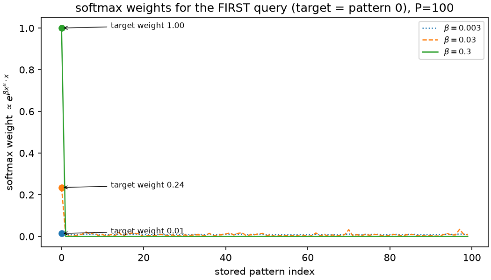

The weights for the first (predeclared) query at P=100 carry 0.01 / 0.24 /
1.00 of the total on the target at β = 0.003 / 0.03 / 0.3, close to the
reference observations. Small β averages many stored digits; large β retrieves one.

## Inverse temperature separates averaging from retrieval

`uv run python scripts/part4_plots.py`

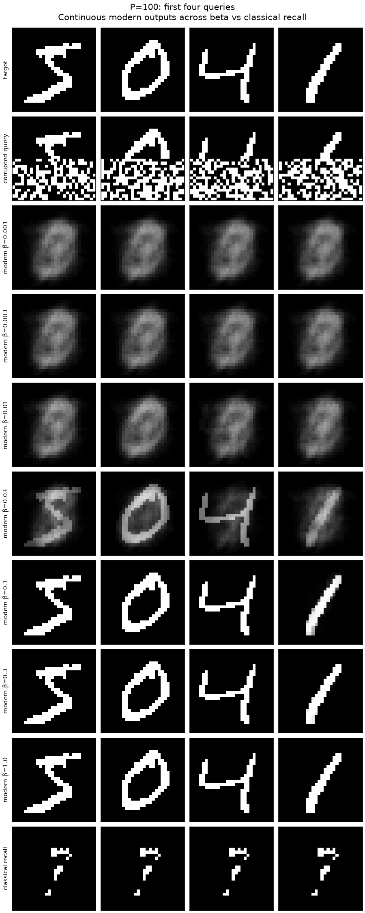

In the four displayed P=100 examples, β ≤ 0.01 returns similar blurred
averages of the stored digits (gray levels preserved — the average is continuous; the sign is only
taken for the success metric). At β = 0.03 the queried digit appears inside
the average; the displayed high-beta outputs closely recover the stored targets. The
success table below quantifies failures across all queries. Classical
recall (Part 3 implementation, same patterns and queries, zero diagonal,
random async order, run to a full zero-flip sweep — all chains converged,
no safety cap) returns the same sparse fragment of strokes for every query:
digit correlations, not load, defeat it.

## Success vs load

`uv run python scripts/part4_plots.py`

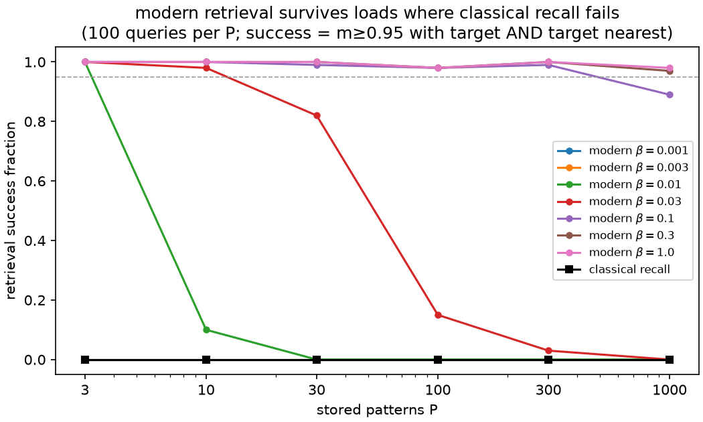

Success = spin overlap of the retrieved sign vector with its target ≥ 0.95
(sign(0)=0 policy, at most 19 wrong pixels of 784) AND the target is the
nearest stored pattern to the result (first-index argmax ties) — the same
criterion for both models, never digit-label accuracy.

| P | modern β=0.3 | classical |
|---|---|---|
| 3 | 1.00 | 0.00 |
| 10 | 1.00 | 0.00 |
| 30 | 1.00 | 0.00 |
| 100 | 0.98 | 0.00 |
| 300 | 1.00 | 0.00 |
| 1000 | 0.97 | 0.00 |

Modern retrieval at β = 0.3 succeeds for ≥ 97% of queries at every P up to
1000 (acceptance ≥ 0.95 ✓); a corrupted query can instead favor another similar stored pattern.
Per-query nearest indices and overlaps are preserved by the acceptance checker. Classical recall
succeeds for NO query at any P (acceptance = 0 ✓), even at P = 3
(α = 0.004): the shared background and shared strokes of digits of the same
class create large signed crosstalk — unlike Part 3's random patterns,
whose crosstalk is zero-mean noise.

**Memorization vs generation.** The modern Hopfield network retrieves one of
the patterns it stored (content-addressable memory, one step); the Part 2
RBM generates novel configurations from a learned distribution. Retrieval
of stored digits says nothing about generating new ones — and vice versa.

Raw arrays (queries, targets, all modern outputs, classical states, sweep
counts, convergence flags) are in
`artifacts/part4/evaluation-20261014-180638/` (git-ignored); compact metrics
in `evidence/part4_metrics.json`; acceptance checker in
`scripts/part4_acceptance.py` (exit 0).

---

# Final verification

- **Unknown target distribution vs empirical distribution.** MNIST/CIFAR-10
  are finite samples (Part 1) from unknown populations; class frequencies
  p̂(y=c) = (1/N)Σₙ1[y₍ₙ₎=c] describe the empirical distribution only.
- **Fitted model and sampling algorithm.** Part 2 fits an RBM energy by CD;
  generation samples the fixed model with block Gibbs. The CD surrogate is
  an approximate likelihood gradient: its data term lowers F on training
  images, while short-chain, stop-gradient endpoints approximate the model
  expectation arising from the gradient of log Z. The endpoints do not
  estimate log Z itself. The surrogate
  need not decrease (our curves rise) and is not the NLL; reconstruction
  error improved from approximately 0.172 to 0.048–0.049, but good
  one-step reconstruction is not proof of good fresh generation, which
  produced stroke-like blobs rather than clean digits.
- **Clamping is inference.** Resetting the observed upper half after every
  Gibbs sweep turns the sampler into one for p(v_M|v_O) with fixed
  parameters: true-upper completions reached ink Dice 0.435 (CD-1) /
  0.522 (CD-10) at 1000 steps vs ≈ 0.25 for wrong-upper controls.
- **Crosstalk and capacity.** Part 3: unstable-bit fractions follow
  Φ(-1/√α) with finite-N corrections; recall crosses 0.9 at
  α = 0.188/0.168/0.157/0.148 (N = 100…800), approaching α_c ≈ 0.138 from
  above. Reference deviation, stated precisely: the minimum low-load
  (α ≤ 0.12) mean overlap is slightly below the reference "above 0.988"
  for exactly TWO sizes (N=200: 0.98795, N=800: 0.98729); N=100 (0.99480)
  and N=400 (0.98950) are above it ; these differences are retained without tuning seeds or thresholds.
  Independent replay and aggregate recomputation passed.
- **Modern update = attention.** The modern Hopfield update and
  `jax.nn.dot_product_attention` with scale=β compute the same vector
  (max diff 0.0 < 1e-5); β moves retrieval from an average of stored
  digits to a single stored digit.

## Limitations

- RBM diagnostics (CD surrogate, one-step reconstruction) do not establish
  NLL decrease; no AIS was computed.
- Fresh RBM generation rarely yields clean digits at this model size.
- Part 3 low-load unstable fractions include exact zeros (resolution
  1/(20·P·N) pooled over sets); min low-load overlaps deviate from the
  reference's 0.988 observation for two sizes as stated above.
- All Part 4 classical chains converged within the 200-sweep cap. No cap
  hit was treated as a completed recall.

## Reproduction and audit notes

Cross-load Part 3 curves reuse derived random keys, so points at different
loads can be correlated; the 20 sets within each point are independent.
Part 4 reports 100 cycling targets per storage size, including only the first
100 targets when P=1000; this is the prescribed query protocol, not a test
of every stored pattern. CPU timings depend on the local environment.

Run `uv run python scripts/part4_acceptance.py` after the experiment to
recompute all query and output checks. It validates the original MNIST bits,
seeded corruption, every beta, independent NumPy arithmetic, actual library
attention, default-scale negative control, per-query success, and stability
of every classical final state. It saves per-query diagnostic arrays beside
the raw run and a compact verification JSON in `evidence/`.

## Complete evidence gallery with producing commands

### cifar10 test frequencies

`uv run python scripts/make_evidence.py`

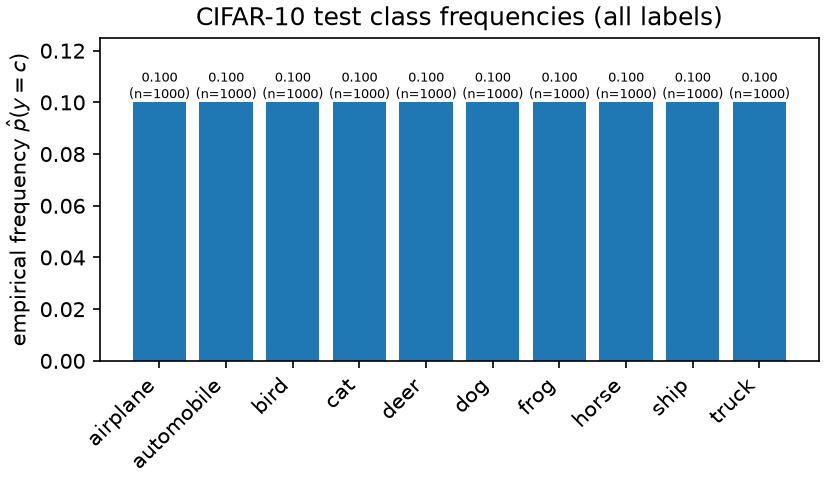

Class frequencies count every record in the original split.

### cifar10 test gallery

`uv run python scripts/make_evidence.py`

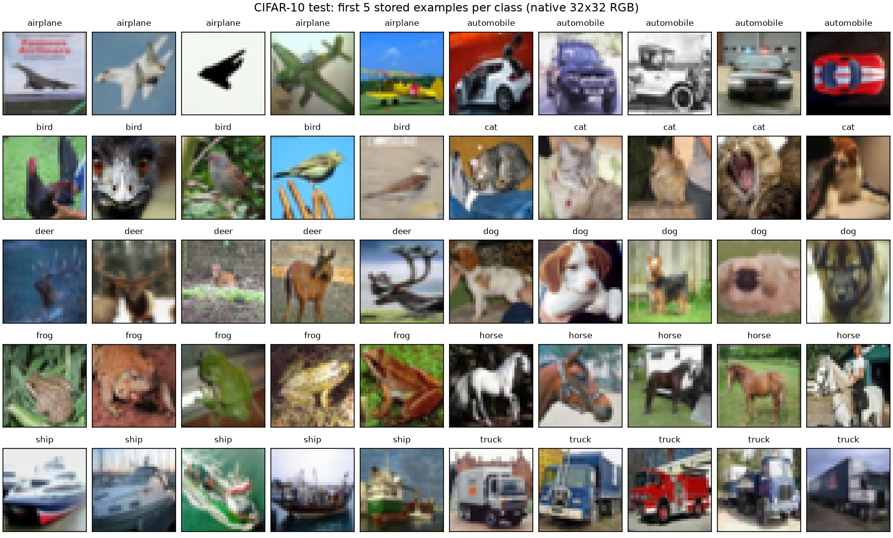

The first five stored examples per class; native pixels, original split.

### cifar10 train frequencies

`uv run python scripts/make_evidence.py`


Class frequencies count every record in the original split.

### cifar10 train gallery

`uv run python scripts/make_evidence.py`

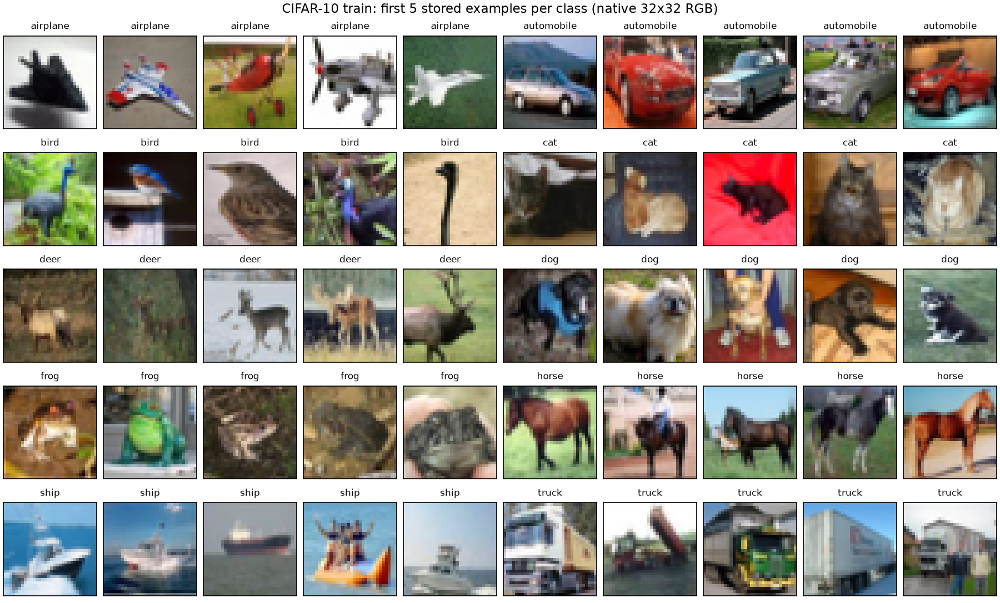

The first five stored examples per class; native pixels, original split.

### mnist test frequencies

`uv run python scripts/make_evidence.py`

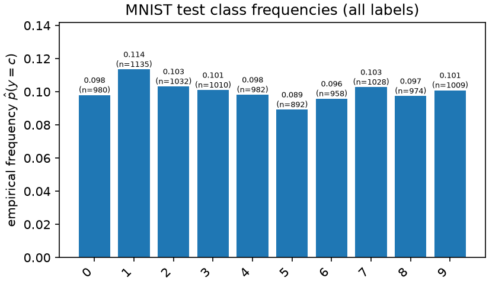

Class frequencies count every record in the original split.

### mnist test gallery

`uv run python scripts/make_evidence.py`

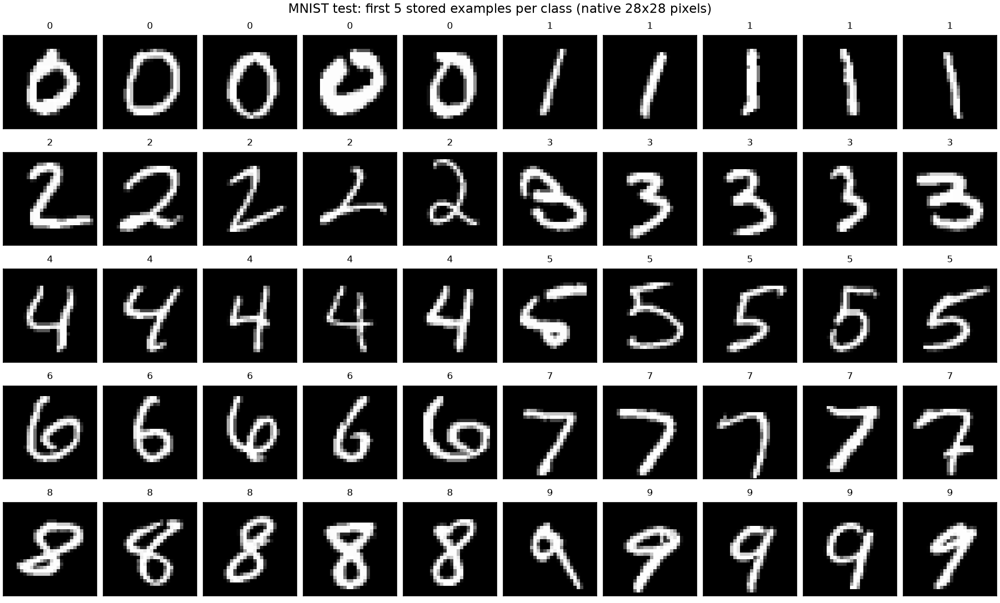

The first five stored examples per class; native pixels, original split.

### mnist train frequencies

`uv run python scripts/make_evidence.py`

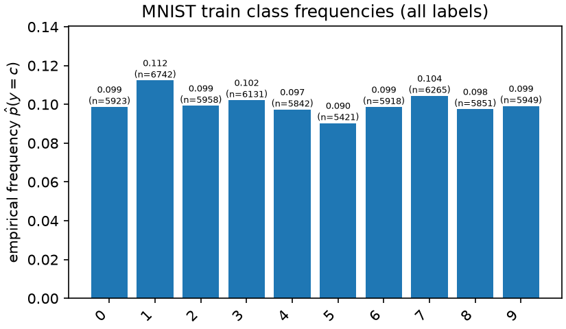

Class frequencies count every record in the original split.

### mnist train gallery

`uv run python scripts/make_evidence.py`

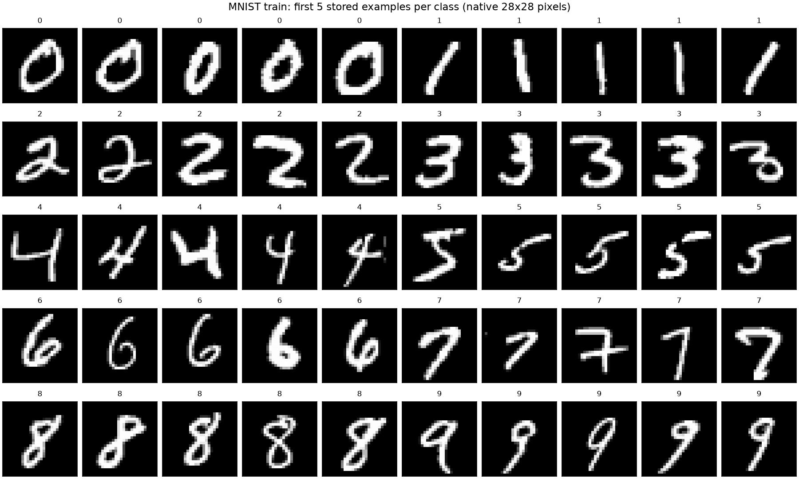

The first five stored examples per class; native pixels, original split.

### part2 binarized first16

`uv run python scripts/part2_verify134.py`

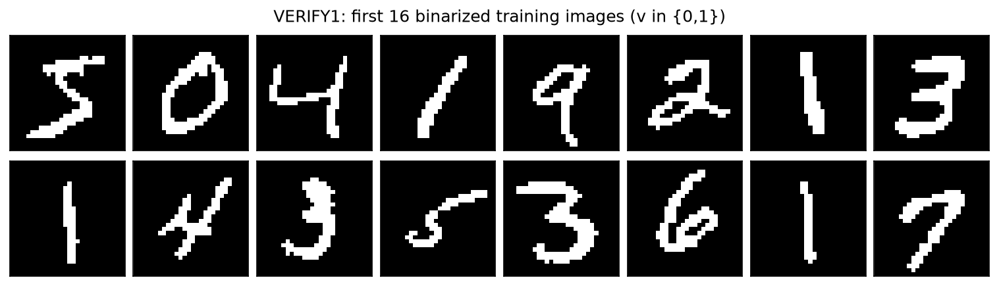

The first 16 training images after the fixed half-intensity threshold.

### part2 completion cd1

`uv run python scripts/part2_verify134.py`

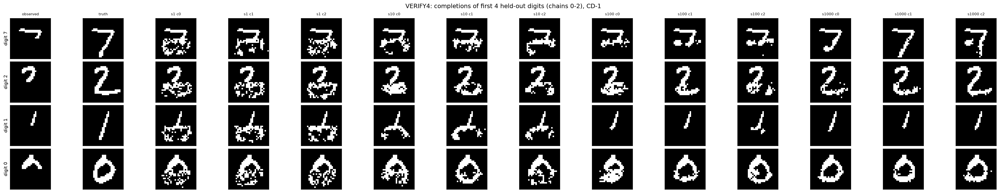

CD-1 conditional samples with the observed upper half held fixed.

### part2 completion cd10

`uv run python scripts/part2_verify134.py`

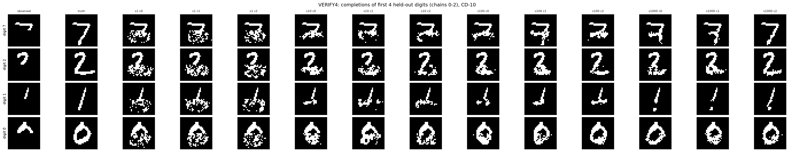

CD-10 conditional samples; outputs vary across sampling chains.

### part2 completion curves

`uv run python scripts/part2_verify134.py`

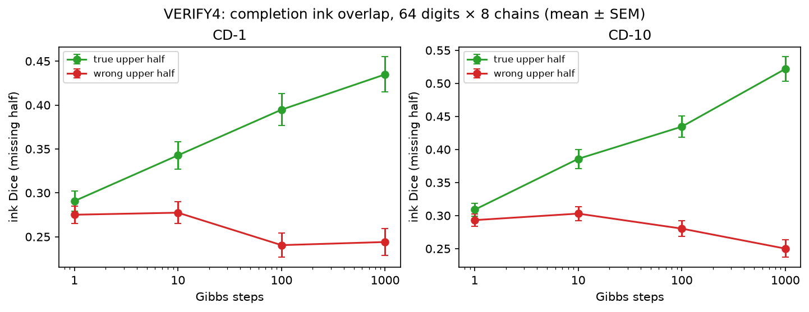

The true upper half gives better missing-half Dice than the wrong-upper control.

### part2 generation cd1

`uv run python scripts/part2_verify134.py`

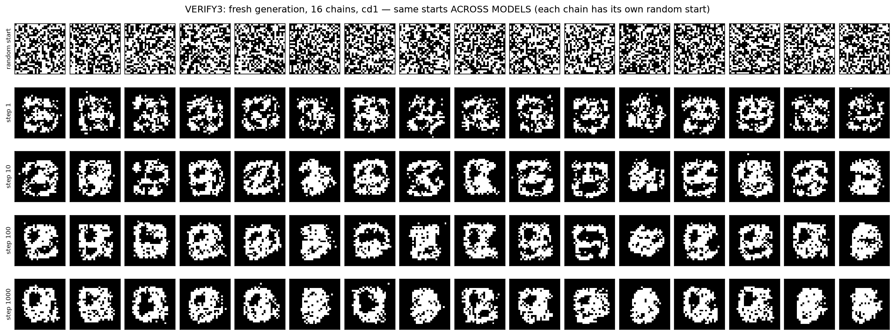

Fresh CD-1 samples form imperfect strokes and blobs.

### part2 generation cd10

`uv run python scripts/part2_verify134.py`

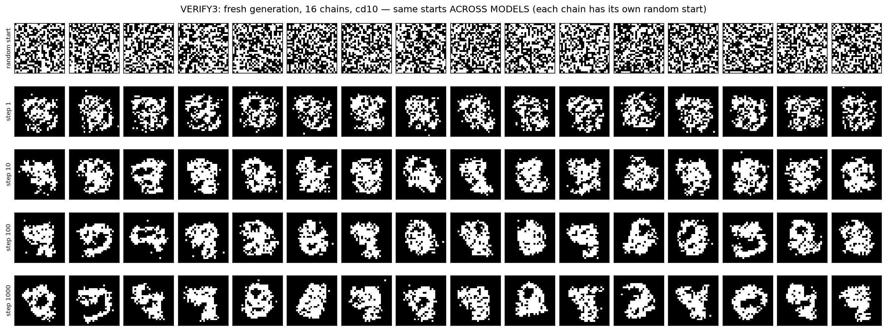

Fresh CD-10 samples remain imperfect despite good reconstruction.

### part2 generation trajectories

`uv run python scripts/part2_verify134.py`

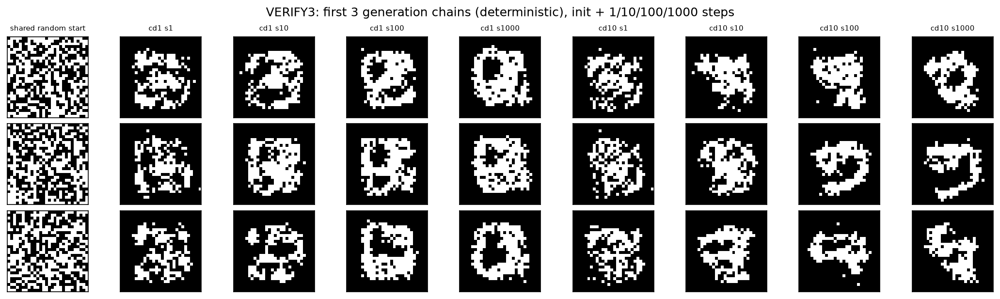

The same random starts are evolved for 1, 10, 100 and 1000 steps.

### part2 learning curves

`uv run python scripts/part2_verify2.py`

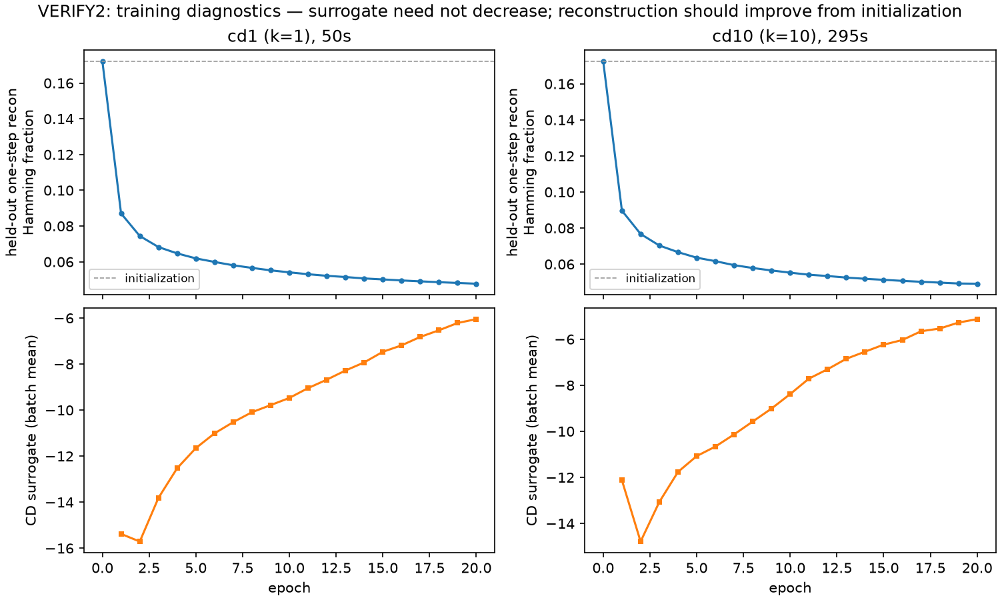

Held-out reconstruction improves; the CD surrogate is not the NLL.

### part2 rbm diagram

`uv run python scripts/part2_verify134.py`

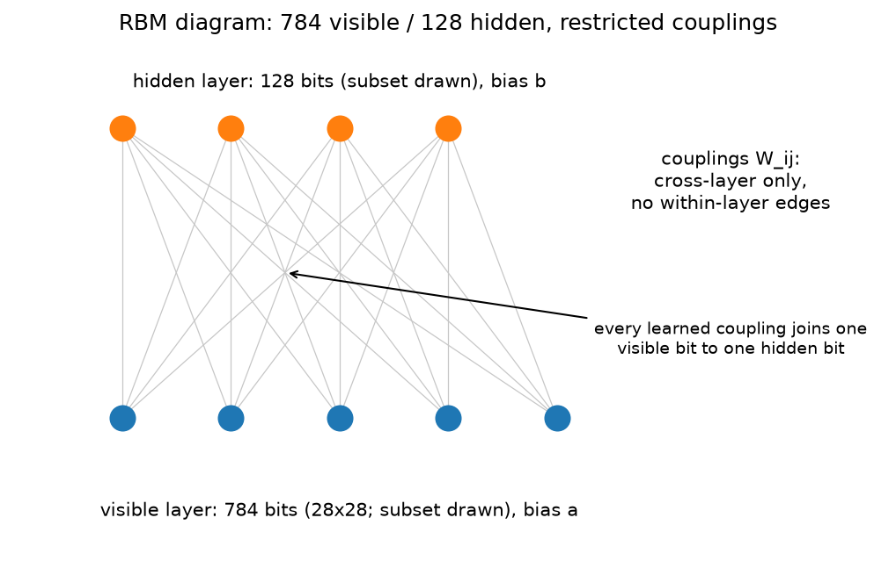

Visible and hidden units connect only across the two layers.

### part2 reconstructions first16

`uv run python scripts/part2_verify134.py`

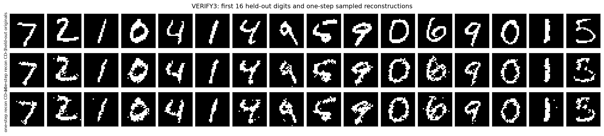

Reconstructions start from held-out digits, unlike fresh generation.

### part2 spin configuration

`uv run python scripts/part2_verify134.py`

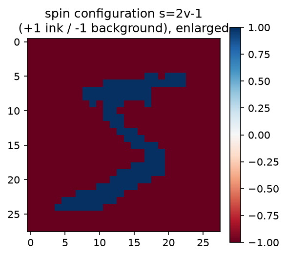

A digit as an Ising spin configuration: ink +1, background -1.

### part3 recall capacity

`uv run python scripts/part3_plots.py`

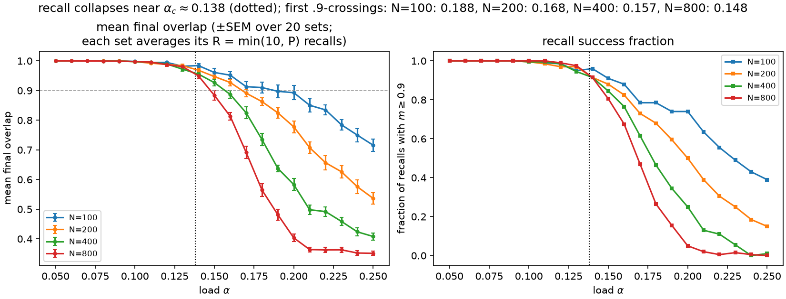

Finite-size recall crossings decrease with N; the low-load reference deviation is retained.

### part3 unstable fraction

`uv run python scripts/part3_plots.py`

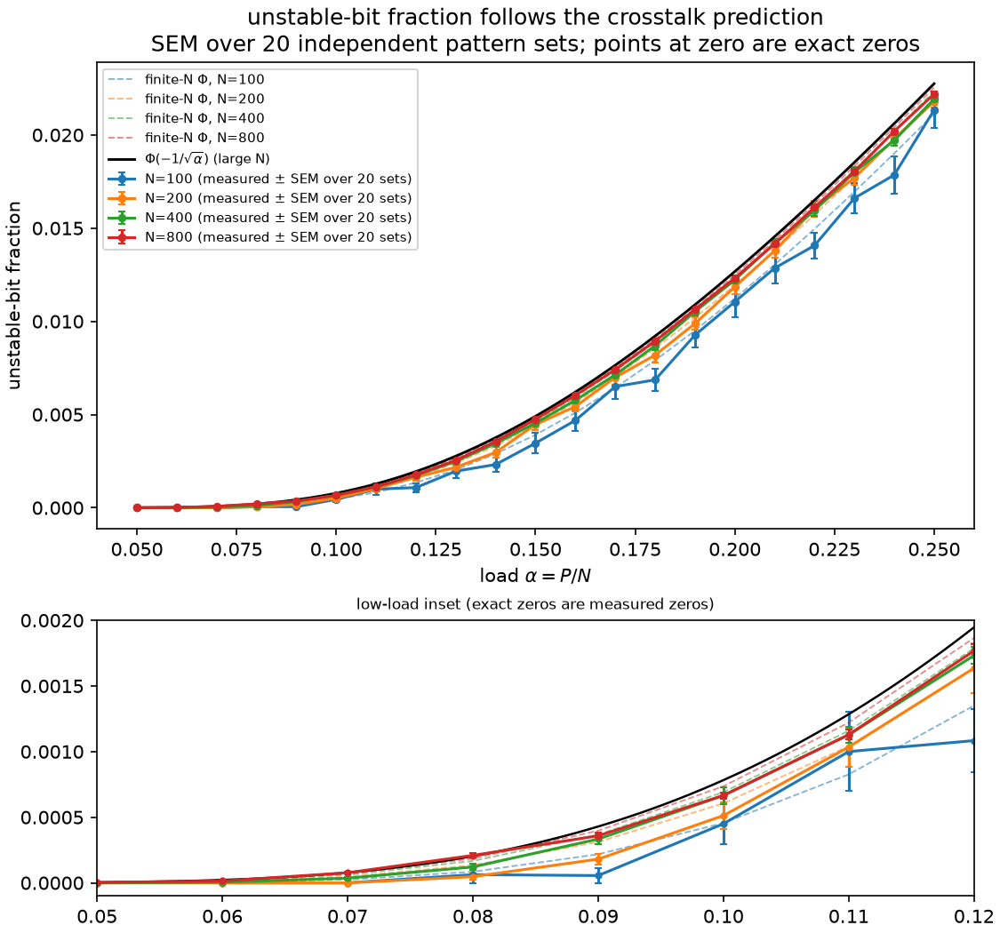

Instability follows the crosstalk trend, with finite-size effects and observed zeros.
