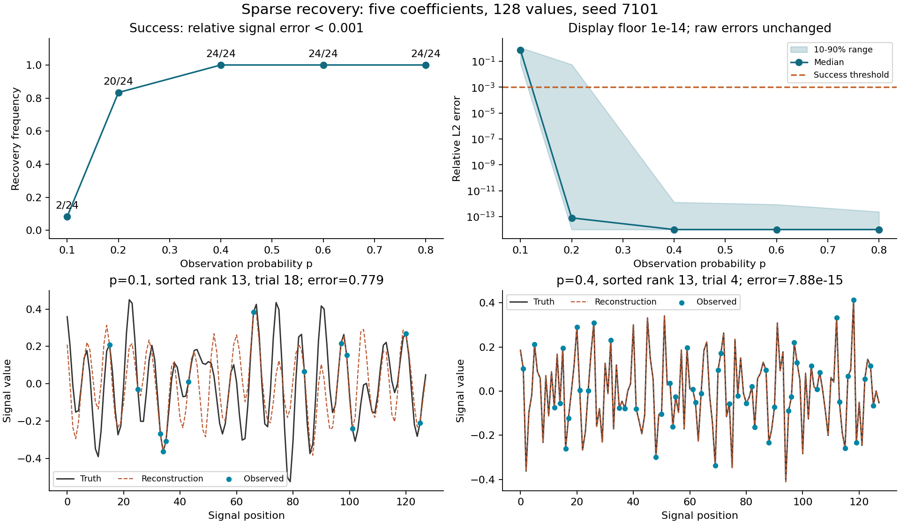
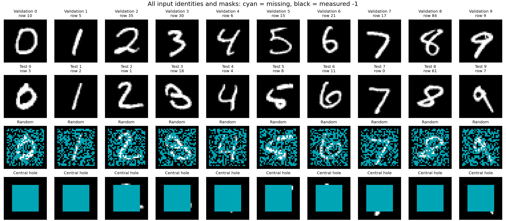
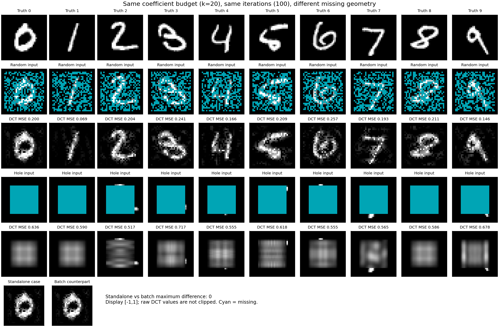
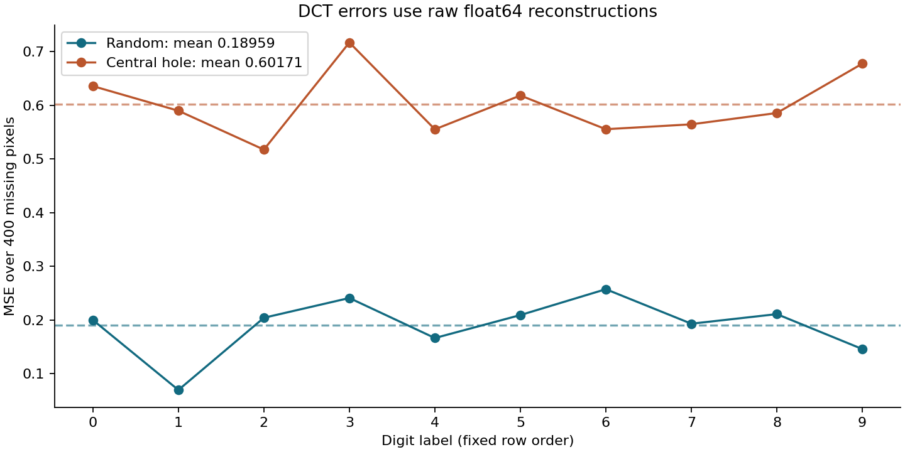
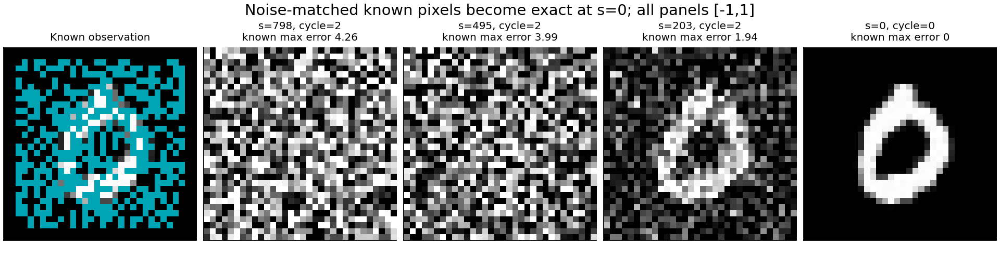
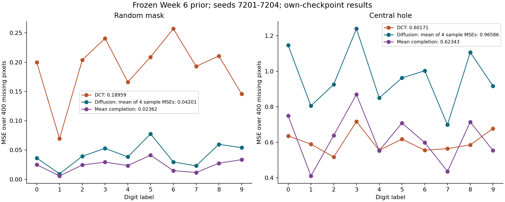
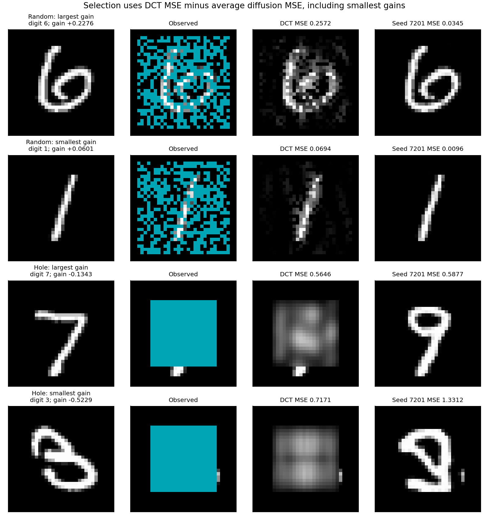
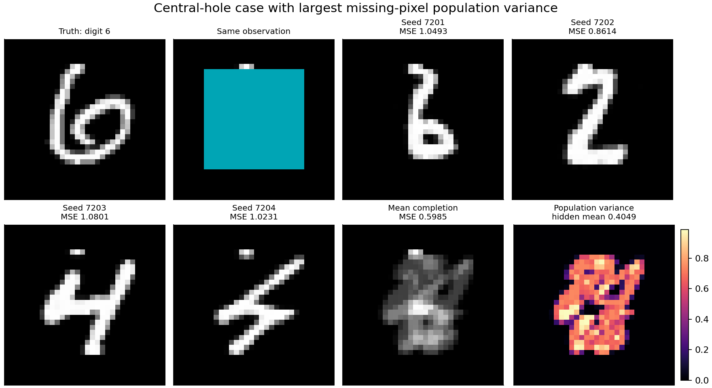

# Week 7: inverse problems and generative priors

This is the local-PDF version identified in [SOURCE.md](SOURCE.md). The live
course week has changed; the selected PDF remains the acceptance authority.
See [SPEC.md](SPEC.md) and [PLAN.md](PLAN.md) for the fixed experimental contract.

## Environment

```bash
uv sync --python 3.11
uv run pytest -q
```

An independent Python 3.11 environment uses pinned NumPy, SciPy, JAX and
matplotlib. The old Week 6 environment requires Python 3.12 and JAX 0.11.2;
this task uses Python 3.11-compatible JAX 0.6.2 and reuses the model source.
Model compatibility is checked before conditional inference. No new training.
`inputs/`, `artifacts/`, environments and caches remain outside Git.

## Part 1: sparse signal recovery

```bash
uv run python sparse.py --size 128 --sparsity 5 --repeats 24 --seed 7101 --out artifacts
uv run python figures.py --part 1
```

The actual success counts are **2, 20, 24, 24, 24 out of 24**, for p=0.1, 0.2,
0.4, 0.6 and 0.8 respectively. The p=.4 goal (at least 23) and p=.1 failure
goal (at least 12) pass. The largest observed-equation residual is 1.78e-11.
An independent DCT and a different LP formulation verify all 120 objectives;
the largest L1 objective difference is 2.46e-10. A hidden-pixel perturbation
negative control is rejected. See [part1-audit.json](evidence/part1-audit.json).



This figure supports recovery at sufficient scattered observations, and
visible failure at p=.1 despite exact observed values. Its bottom rows are
sorted rank 13, original trials 18 and 4, selected by the specified rule.
The error display floor does not alter saved numeric errors. A 24-trial
frequency is specific to this experiment, not a universal threshold.

In [Candes and Romberg's abstract](https://arxiv.org/abs/math/0611957), sparsity
and coherence both enter the sample requirement. Sparse coefficients reduce
the unknown structure; incoherent measurements spread information across
those coefficients. Sparsity alone does not make every measurement geometry
recoverable. DCT-II basis pursuit here is convex; the later hard-thresholded
image iteration is a different, nonconvex approximation.

## Part 2: DCT image inpainting

The live image download belongs to another exercise. The exact MNIST test rows
in the selected PDF were reconstructed from original official IDX files with
verified digests, without selecting new images. The first/second occurrence
of each digit is checked explicitly. Validation images are displayed but never
evaluated or fed to reconstruction. See [input provenance](evidence/input-provenance.json).

```bash
uv run python prepare_inputs.py
uv run python study.py --input inputs/images.npz --out artifacts
uv run ./inpaint --method dct --input inputs/case.npz --k 20 --iterations 100 --out artifacts/case
uv run python figures.py --part 2
```

Mean missing-pixel MSE is **0.1895889244** for random masks and **0.6017061911**
for central holes, within .0001 of both lecture values. Every mask has 400
missing pixels and 624 known pixels; only 384 known pixels belong to the
original digit, because the border contributes 240. Observed maximum error is
0. The standalone tool matches its batch counterpart exactly. An independent
dense cosine-matrix reconstruction of all 20 cases differs by at most 4.14e-14.
Full per-image values and negative-control result are in
[part2-audit.json](evidence/part2-audit.json).



`input-images.png` identifies all ten validation and evaluation rows and both
masks. Cyan is missing, and black is a measured -1 intensity. For digit 0
(official row 3), padded image pixel (row 6, column 17), with value .584314,
is observed under the random mask but lies inside the unmeasured hole. Most
central strokes of this digit have no direct hole-case measurements.



`fixed-inpainting.png` shows both masks, all ten reconstructions and standalone
agreement. DCT values range from -1.59762 to 1.05718 and are stored without
clipping. Every grayscale panel has display scale [-1,1]; numerical errors use
raw values. No hidden pixel enters either solver.



`fixed-error.png` contains all individual errors and mean lines. The hole mean
is 3.17374 times the scattered-mask mean at the same k=20 and 100 iterations.
The scattered mask samples strokes throughout the image, whereas a contiguous
hole can erase a whole stroke. Equal counts therefore do not imply equal
information. This iteration alternates a hard transform budget with exact
observed restoration; it is not Part 1's convex basis pursuit, and 100 iterations
are a fixed budget rather than a proof of convergence. Errors are averaged
only over the 400 withheld pixels, not diluted across all 1024 pixels.

## Part 3: frozen diffusion prior

```bash
JAX_PLATFORMS=cpu uv run python study.py --input inputs/images.npz --checkpoint ../week6/checkpoints/mnist.npz --out artifacts
JAX_PLATFORMS=cpu uv run ./inpaint --method diffusion --input inputs/case.npz --checkpoint ../week6/checkpoints/mnist.npz --steps 100 --repeats 3 --seed 7201 --out artifacts/case-diffusion
uv run python figures.py --part 3
```

The checkpoint SHA-256 is
`8b9b1a4704cf4fd1f8f4258c78e370db85ac0eca228cbc0bc03f2543e960f11d`.
It contains 336385 frozen EMA parameters from the Week 6 MNIST run, 30000
updates, batch 64, seed 2026. The existing loader and network are imported
directly from `../week6/src`; no retraining or copied/reinterpreted architecture.
Two deterministic input comparisons between the old JAX 0.11.2/Python 3.12
environment and this JAX 0.6.2/Python 3.11 environment had maximum prediction
difference 3.70e-6. This checks those inputs, not every possible network state.
See [model compatibility](evidence/model-compatibility.json).

The 20-image batch is processed once per seed in order 7201,7202,7203,7204.
Each seed uses 298 network evaluations, with 100 reverse levels and three
attempts per transition except the final transition. Measured sampling times
were 8.570, 7.541, 7.834 and 7.730 seconds on local CPU, including compilation
in the first seed. Input arrays, DCT outputs and the checkpoint are unchanged.

| Mask | DCT MSE | Mean individual-sample MSE | Mean-completion MSE | Missing-pixel population variance |
| --- | ---: | ---: | ---: | ---: |
| Random | 0.1895889244 | 0.0420107781 | 0.0236204449 | 0.0183903332 |
| Central hole | 0.6017061911 | 0.9658646375 | 0.6234262249 | 0.3424384125 |

These are this student's own-checkpoint results, not copied reference outputs.
All four completions satisfy all observations exactly; maximum final observed
error is 0. Diffusion improves every random-mask digit's average error here,
but worsens every central-hole digit's average error. Improvement is not the
Part 3 acceptance condition.



`conditioning.png` shows final attempts at s=798,495,203,0, the saved levels
nearest 800,500,200,0. Known pixels are noisy during inference and exact only at
zero. Every frame uses [-1,1] display scaling, with unrounded float32 states
saved in `artifacts/trace.npz`. The reverse mean uses the clipped clean estimate;
the merged intermediate state is never clipped.



`recovery-curves.png` shows all ten per-image errors for both masks, including
the difference between averaging four individual errors and evaluating the
mean image. It supports the different effects of the prior on the two fixed
observation geometries. Known-pixel restoration alone is not evidence of
recovery of the withheld truth.



`inpainting-comparison.png` selects largest/smallest gains using DCT error minus
diffusion error averaged over four seeds; it displays seed 7201 as requested.
The selected random-mask digits are 6 and 1, and hole digits are 7 and 3.
Both selected hole gains are negative. For hole digit 7, the seed-7201 output
has a closed upper loop resembling a 9, whereas the withheld truth has an open
7 stroke. The generated loop lies within the unobserved hole: plausible
digit structure is not a measurement and does not establish true recovery.



`completions.png` uses hole digit 6, the case with the largest missing-pixel
population variance. The four draws disagree on central vertical/diagonal
strokes and loops. Their mean blurs these differences. The variance map is zero
at observed pixels and bright only in the hole. Its spread describes these
four draws; it is not a calibrated posterior uncertainty estimate.

The float64 ensemble identity is
`mean(sample MSE) = MSE(mean image) + mean(population variance on missing pixels)`.
The largest residual across all 20 cases is **1.66534e-16**, below 1e-6. The mean
cannot have higher MSE than the average sample; it need not look like a digit
or beat every single draw. A ddof=1 sample-variance negative control violates
the identity, as expected.

In [RePaint sections 4.1-4.2 and Figure 3](https://arxiv.org/html/2201.09865v4),
known-region replacement conditions a pretrained unconditional denoiser.
Revisiting noise levels lets generated and measured content interact again.
This exercise uses the local lecture's shortened schedule and mask convention,
not an exact reproduction of the paper's models or experiments. More resampling
does not guarantee lower MSE; exact posterior sampling is not established.

The [Part 3 audit](evidence/part3-audit.json) independently checks all saved
noise predictions and all 298 trace transitions, replaying the specified PRNG
stream in the full batch shape. Maximum algebra differences against a float64
reference were 1.63e-5 (reverse), 2.38e-6 (forward) and 3.04e-6 (conditioning);
re-evaluated network predictions matched every saved trace prediction exactly.
These are numerical implementation checks, not proof of exact posterior draws.

## Reproduction and final demonstration

Run commands above in order from a fresh `week7/` checkout, with the existing
Week 6 source/checkpoint alongside it. Outputs refuse unrelated overwrites;
use fresh output folders for new studies. `prepare_inputs.py` can download the
two official test archives if the existing Week 6 dataset is unavailable.
The diffusion extension preserves `artifacts/dct-evidence.npz` and
`artifacts/dct-run.json` before adding diffusion fields.

```bash
JAX_PLATFORMS=cpu uv run pytest -q
uv run python -m compileall -q sparse.py inpainting.py prepare_inputs.py repaint.py study.py figures.py tests
uv run python figures.py --part all
git diff --check
```

The eight figures above are the complete visual evidence set. Present in this
order: sparse recovery, two image masks and DCT errors, conditioning, recovery
comparison, four consistent but disagreeing completions. The assumptions are
respectively sparse exact coefficients, an approximate fixed cosine budget,
and a learned distribution of digits. Hidden-pixel errors distinguish fitting
the measurements from recovering truth. The ensemble identity explains the
MSE effect of averaging, with no guarantee of a plausible mean image.

The selected PDF says to show these results at the start of Week 8 and that
nothing is submitted. Automated completion does not certify the student's
understanding or instructor acceptance. Full command/failure/delivery details
are recorded in [AUDIT.md](AUDIT.md).
