# Week8 revised: Language models and the transformer

All six required parts were executed against the updated24-page worksheet. **One scientific gate remains unmet:** the outer-product capacity slope is0.87127, outside0.9–1.1. This is reported as a failure; seeds and thresholds were not changed. All other declared gates passed. See [acceptance](evidence/ACCEPTANCE.json), [delivery report](DELIVERY_REPORT.md), [Chinese learning guide](LEARNING_GUIDE_ZH.md), and [fixed-seed stories](SAMPLES.md).

Authoritative worksheet SHA256: `4e33bea929459c01511efc0298308a93d08d99ee7df38372bbf52e89be69cc35`. The user selected **算 (U+7B97)**. This task lives in its own subdirectory; all876 pre-existing tracked files at24a860b remain byte-identical.

## Measured results

| Part | Result | Status |
|---|---|---|
|1 relations|LOO means0.466 /0.549 /0.433; shuffled+0.029 /−0.015 /+0.009|PASS|
|2 n-grams|best4-gram1.309751 bpc; explicit512³ enumeration; sampler p=.150907|PASS|
|3 memory|d64 capacities outer66.96,LS128.75; outer slope.87127|One gate FAIL|
|3 MLP|3.044388 nats/token; bigram difference+.006196;4000 updates|PASS|
|4 picture|all320 ratios independently reproduced; softmax R(4096)median.05508|PASS|
|5 Transformer|1.207246 bpc;6000 updates; causality/sampler/entropy checks pass|PASS|
|6 scaling|α=.34731,β=.36717,E=1.81722;D*/N*=17.92 [7.89,34.11]|PASS|

Every language model scores exactly1,078,995 actual validation targets; every bpc uses2,213,915 original Unicode characters. The initial EOS is context only. BPE merges common character/byte sequences into512 token IDs; this differs from the pretrained WordPiece embedding vocabulary of29,528 rows. All4 pinned input URLs, hashes, schemas and split conventions are in [INPUTS](INPUTS.md) and [SPEC](SPEC.md). The corpus URL is
`https://huggingface.co/datasets/roneneldan/TinyStories/resolve/f54c09fd23315a6f9c86f9dc80f725de7d8f9c64/TinyStoriesV2-GPT4-valid.txt`.

The recalled picture is the fixed32x32 glyph among random±1 pictures. Its norm is32; ISR divides interference by the own-weight contribution, including that norm. The final image corrects a transposed earlier plot and removes its upper dot-area clipping. Numeric outcomes are unchanged; old images remain.

The Chinchilla fit uses only the240 filtered published runs, log-Huberδ=.001,243 starts and400 fixed resamples. The refit mean log residual is−.000656; printed parameters give+.016742. Optimizer exits were by relative function reduction; the best projected gradient infinity norm was2.25e-6, not1e-12. This fit is separate from our TinyStories models and the historical worksheet.

## Runtime and verification

Native WSL Pi (`volcengine-plan/glm-5-3-flash`) authored the core models, drivers and test suites. Codex coordinated, identified defects, mechanically completed test indentation after a quota interruption, executed the formal jobs once, and wrote the independent audit/rendering tools. The original delivery at `a00bcc9` used no MiniMax/provider fallback. A subsequent explicitly authorized MiniMax advisory review is documented below. Pi task07 ended in an explicit quota error; its exit0 was not treated as success. Already-created code was verified locally, without further provider inference.

Final audited runtime: Python3.11.17, JAX/JAXlib0.6.2 CPU, NumPy2.2.6, SciPy1.17.1, Matplotlib3.10.3, SentencePiece0.2.2. Versions pinned byuv.lock; pyproject permits Python3.11–3.12. No PyTorch/cloud model training.

```bash
cd week8/language-models
uv sync --frozen
JAX_PLATFORMS=cpu OPENBLAS_NUM_THREADS=1 .venv/bin/python -m pytest tests -q
```

Independent final review:95 tests passed, plus full-data numeric/statistical checks. A test pass is distinct from a worksheet scientific gate: the outer slope still fails.

## Producing commands

Commands document the original named runs. Attempts are exclusive and existing attempts cannot be overwritten. Use a fresh attempt name for an intentional new run. Raw artifacts/checkpoints are local and ignored byGit; plotting/auditing requires those saved artifacts, not merely the public figures.

```bash
.venv/bin/python src/run_part1.py
.venv/bin/python src/run_part2.py --attempt formal-02
OPENBLAS_NUM_THREADS=8 .venv/bin/python tools/run_memory_formal.py --attempt memory-formal-01
JAX_PLATFORMS=cpu .venv/bin/python src/train_models.py --model mlp --attempt formal-01
.venv/bin/python src/run_part4.py --attempt formal-01
JAX_PLATFORMS=cpu .venv/bin/python src/train_models.py --model transformer --attempt formal-01
OPENBLAS_NUM_THREADS=1 .venv/bin/python tools/run_scaling_formal.py --attempt formal-01
```

The original exact controller dispatch receipts/source snapshots and all raw outcomes remain locally; portable orchestration wrappers reproduce the same frozen kernels. The unused older convenience bootstrap helper in`src/scaling.py` is not the canonical entry: the formal wrapper calls`fit_once` exactly once per fixed resample and saves every status/end parameter. No failed bootstrap was retried (all400 converged).

## Evidence figures and their producing commands

### All27 relation pairs; equal-aspect angles and fixed shuffle.

Producing command: `.venv/bin/python tools/render_audited_figures.py`

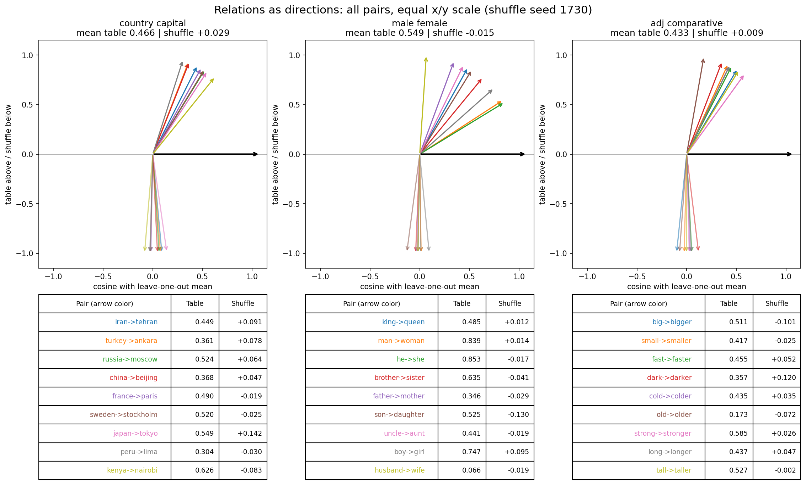

### Count-model loss and unseen fractions; cited formal-02.

Producing command: `.venv/bin/python tools/render_audited_figures.py`

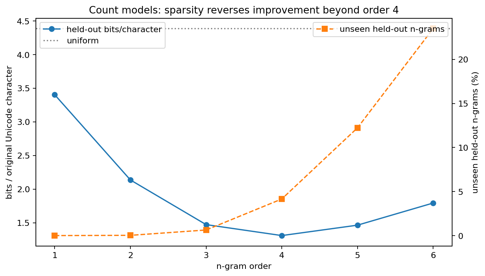

### 630 all-query cases; outer capacity slope FAIL retained.

Producing command: `.venv/bin/python tools/audit_memory.py`

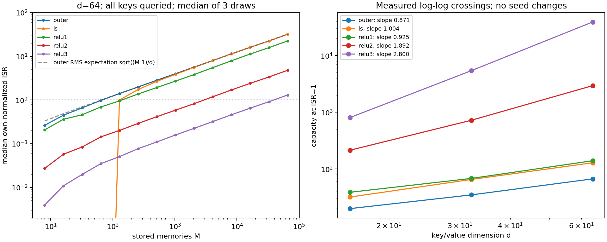

### Fixed user-selected32x32 bitmap; +1 ink/-1 background.

Producing command: `.venv/bin/python tools/render_audited_figures.py`

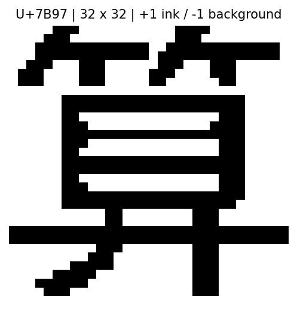

### Predeclared showcase531504, correct row/column orientation, unclipped dot areas.

Producing command: `.venv/bin/python tools/render_audited_figures.py`

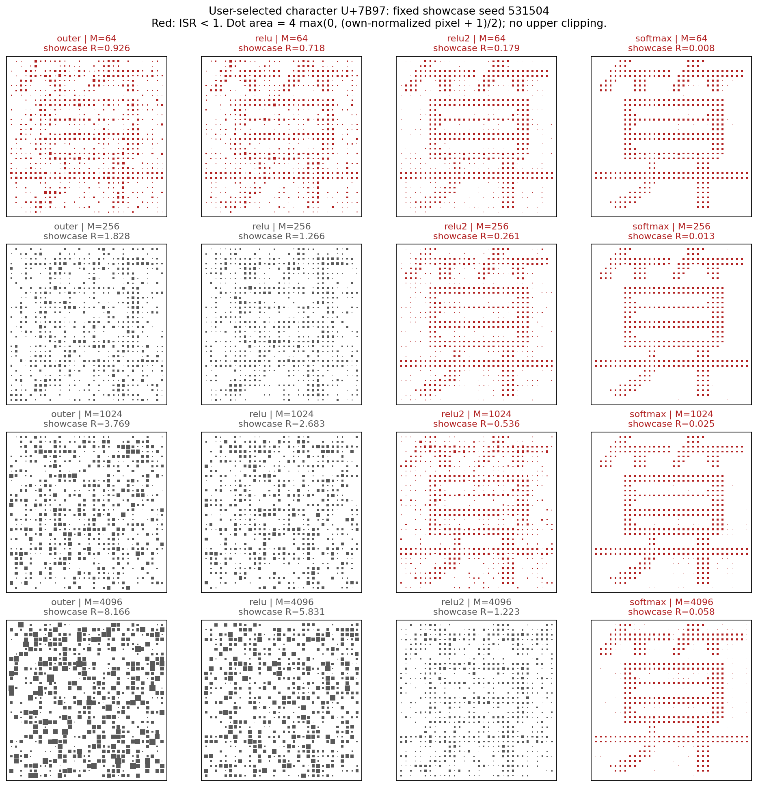

### Actual stochastic losses; first128-window held-out curves explicitly PARTIAL.

Producing command: `.venv/bin/python tools/audit_neural.py`

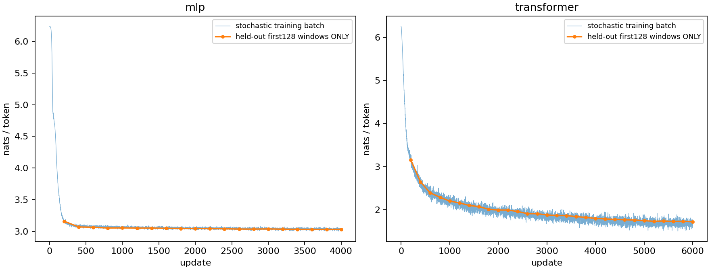

### All models on identical targets and original-character denominator.

Producing command: `.venv/bin/python tools/audit_neural.py`

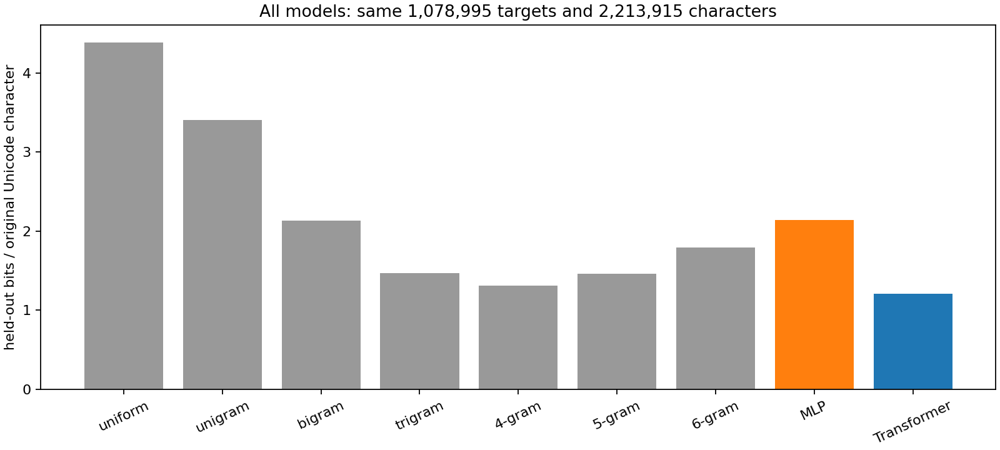

### Full held-out per-position means and two-SE bands.

Producing command: `.venv/bin/python tools/audit_neural.py`

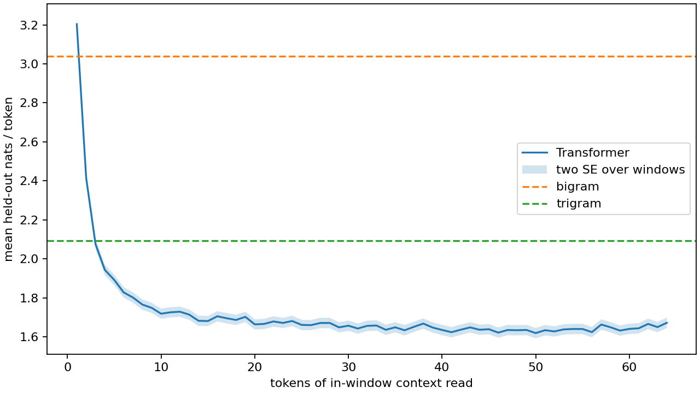

### Optional: all8 heads of fixed first held-out window.

Producing command: `.venv/bin/python tools/audit_neural.py`

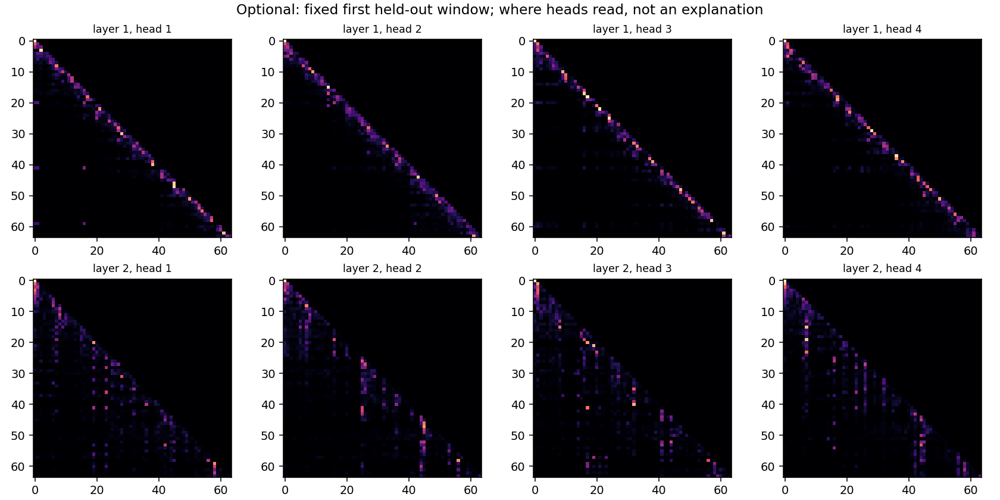

### Budget curves and residual means.

Producing command: `.venv/bin/python tools/render_audited_figures.py`

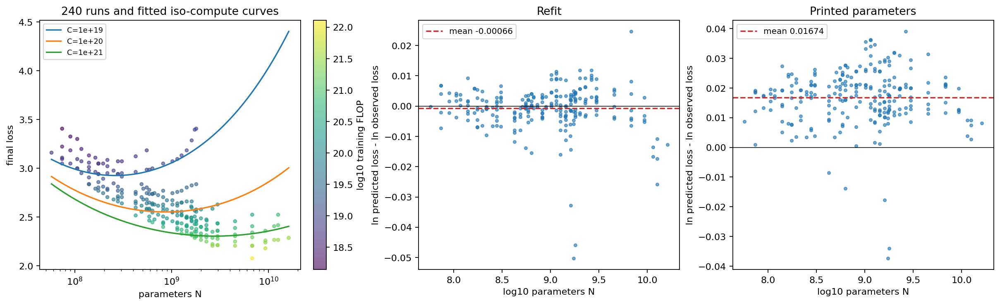

### Measured vsfitted240 losses and residual histograms.

Producing command: `.venv/bin/python tools/render_audited_figures.py`

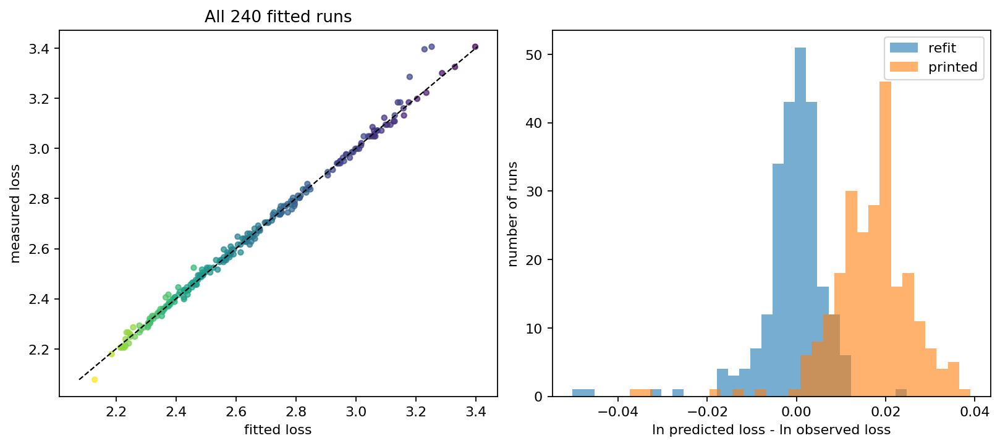

### Refit and printed N*,D* curves; Chinchilla and400-bootstrap interval.

Producing command: `.venv/bin/python tools/render_audited_figures.py`

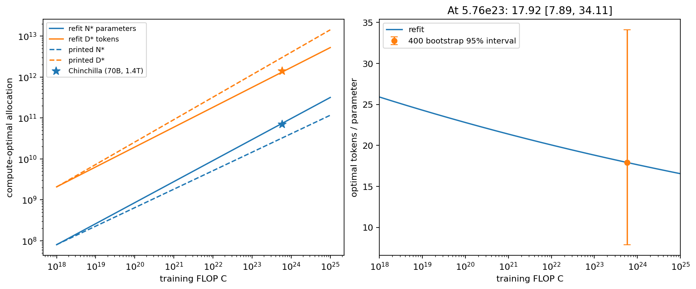

## Source/input/output map

| Source | Input | Output |
|---|---|---|
|corpus.py /part1_embeddings.py|pinned text/tokenizers/embedding table|verified streams, relation JSON|
|ngrams.py /run_part2.py|same training/validation streams|exclusive count-model results and raw sampler arrays|
|memory_sweep.py /memory.py|frozen unit-vector draws|630 cases and capacity curves|
|part4_glyph.py /run_part4.py|user-selected glyph and fixed20 draws|bitmap, all320 ISR outcomes|
|mlp_model.py /transformer_model.py /train_driver.py|fixed random training positions|initial/mid/final params,Adam states,PRNG and logs|
|sampling.py /selfconsistency.py /tools/audit_neural.py|saved final weights|independent scores, sampler tests, stories, entropy, figures|
|scaling.py /tools/run_scaling_formal.py|245 pinned published runs|243-start traces,400 resample traces and bootstrap estimates|

No corpus, downloaded model, tokenizer binary, raw checkpoint, font file, auth file or raw Pi session is committed. [Failure register](evidence/failures/failure-register.json) preserves unsupported/failed attempts and corrections; [old-file verification](evidence/audits/old-work-preservation.json) binds the historical baseline. Scientific acceptance remains partial because of the declared slope failure.

## Subsequent authorized MiniMax review

The user subsequently authorized an independent MiniMax channel through native WSL Pi. The connection test and narrowed review completed; the initial truncated review remains rejected and preserved. Independent reconstruction still gives outer slope **0.87127**, so the original failed gate remains unchanged. No training or random draws were added. See the [follow-up report and receipts](evidence/minimax-followup-20261028/README.md).
