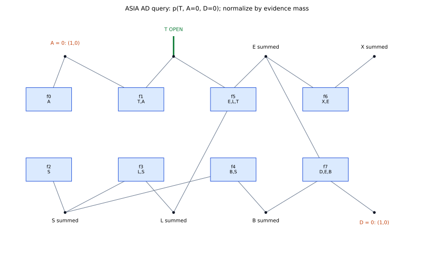
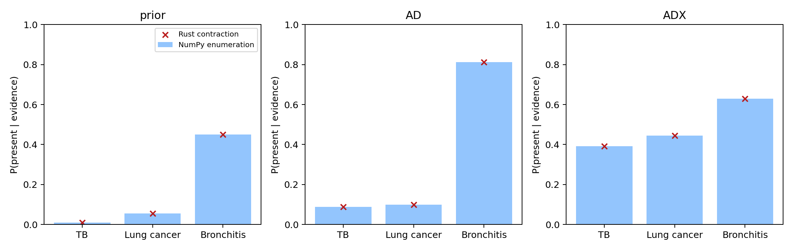
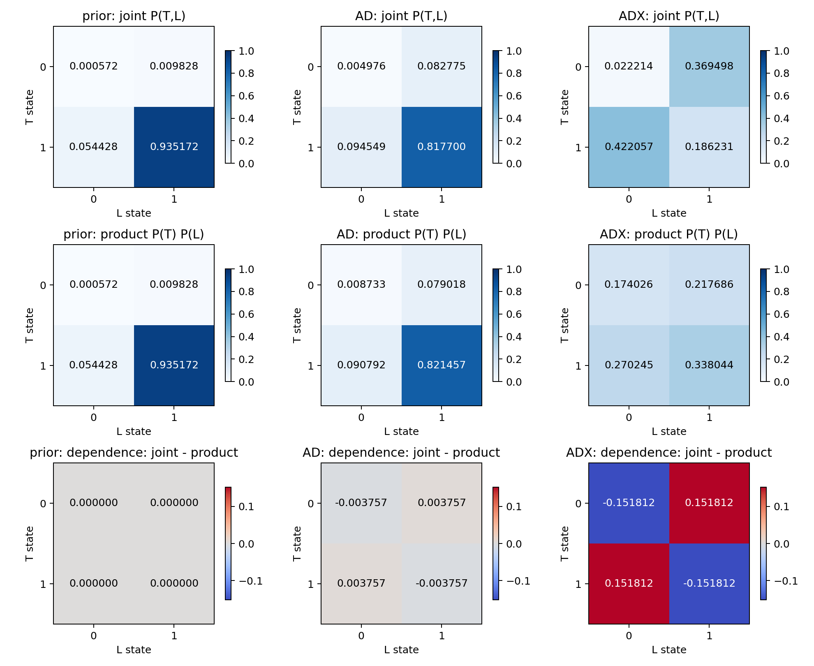
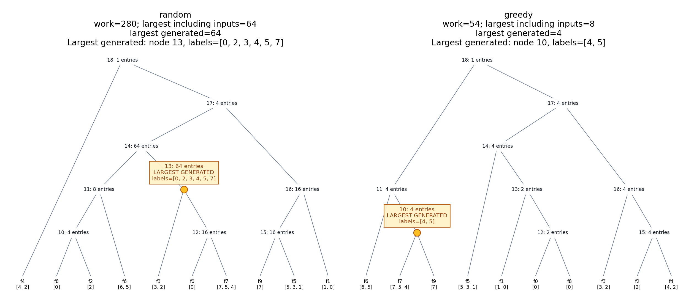
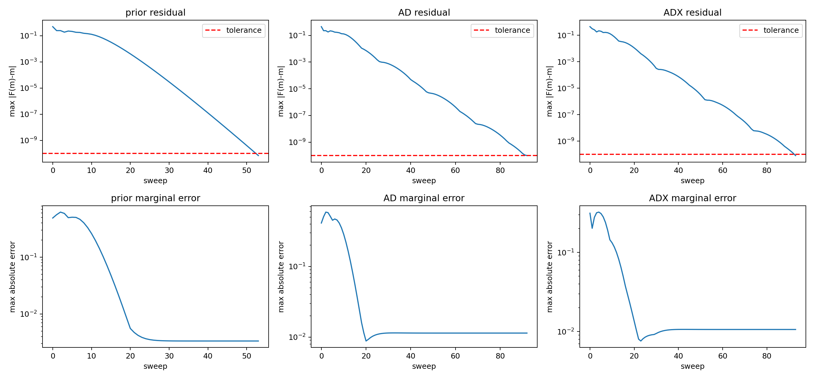
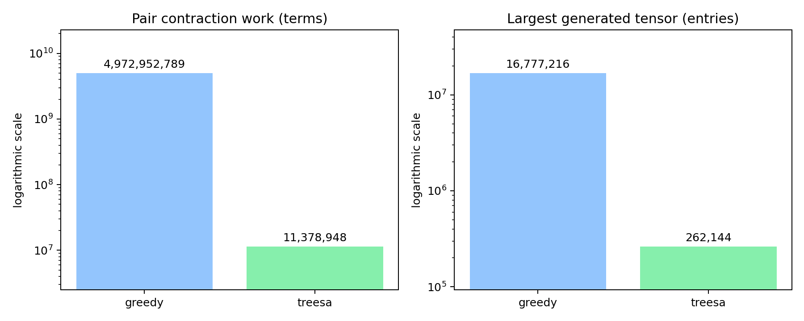
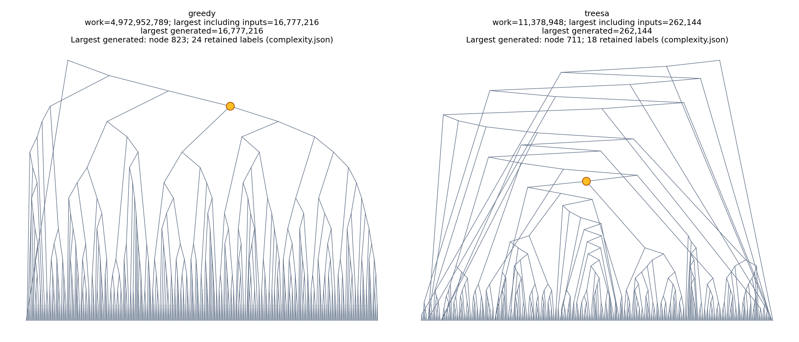
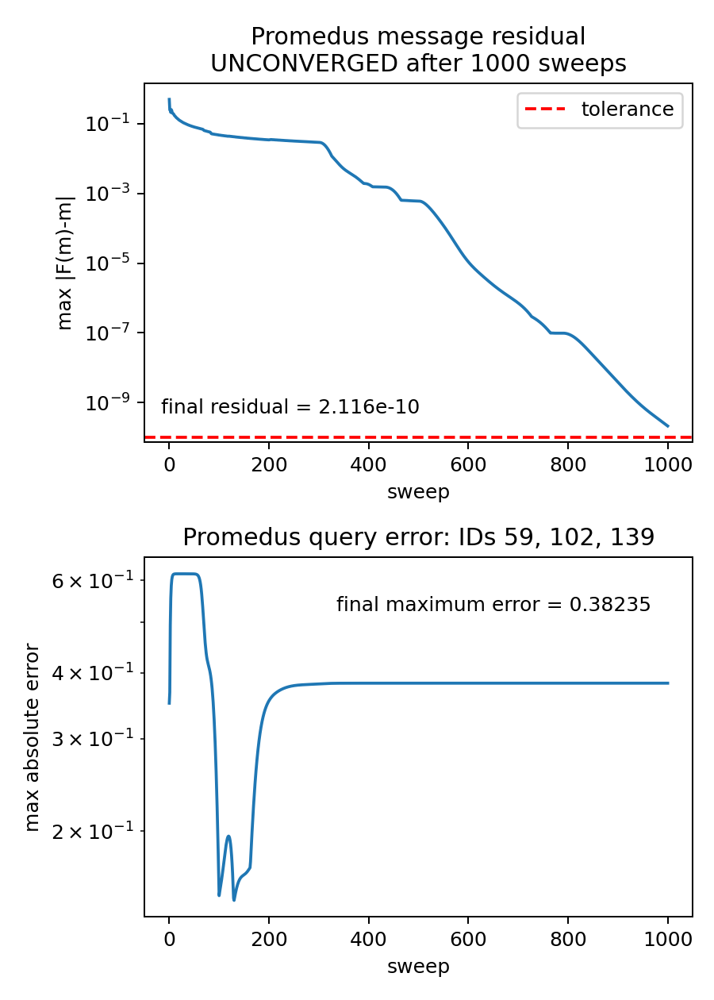

# Week 9: Probabilistic inference by tensor contraction

Completed hands-on evidence from the 15-page Week 9 learning sheet. Start with [the Chinese step-by-step guide](week9-学习指南.md) and [the implementation contract](infer.design.toml).

## Environment and reproduction

Rust 1.96.0 (ac68faa20), f64, CPU serial execution; tenferro-tensor/cpu/einsum 0.9.0 and omeco 0.2.6, exact dependency versions in Cargo.lock. CPU uses the native backend, with GPU/autodiff features disabled. Python 3.11, NumPy 2.2.6 and Matplotlib 3.10.3. The actual local environment is WSL Ubuntu 24.04. All delivered runs use the final optimized release executable; earlier independently verified debug runs are preserved in local support archives. Runtime is internal elapsed time through inference, excluding final JSON serialization; it includes planning. Initial compilation is not included.

The recovered release build uses `opt-level=1` and two Cargo jobs. Set the following to reproduce that profile; the supplied reproduction script sets both automatically. Actual hardware is recorded in [environment.txt](environment.txt).

```bash
rustup toolchain install 1.96.0 --profile minimal
export CARGO_PROFILE_RELEASE_OPT_LEVEL=1
export CARGO_BUILD_JOBS=2
python -m pip install -r requirements-plot.txt
cargo +1.96.0 test --locked
python -m unittest discover -s tests -p 'test_python_audit.py'
python verify_and_plot.py
# Fresh full computation; preserves checked-in runs in a new reproduction folder:
bash reproduce.sh
```

`reproduce.sh` installs with `cargo +1.96.0 install --locked --path .`. Ensure Cargo's bin directory is on PATH. For one run, use `infer --model asia.uai --evidence AD --out NEW_DIRECTORY`. Existing artifact files are never overwritten. Detailed original commands are in the Chinese guide. BP always computes all node beliefs; exact Promedus queries only IDs59, 102, 139.

## Build 1: exact ASIA

| Case | P(evidence) | P(T=0) | P(L=0) | P(B=0) | Max marginal error |
|---|---:|---:|---:|---:|---:|
| prior | 1 | 0.0104000000 | 0.0550000000 | 0.4500000000 | 1.11e-16 |
| AD | 0.004501375 | 0.0877509650 | 0.0995251451 | 0.8114020716 | 1.11e-16 |
| ADX | 0.00098822675 | 0.3917117200 | 0.4442705078 | 0.6288217760 | 2.22e-16 |

All node and T/L-joint marginals normalize; independent NumPy UAI enumeration checks absolute errors and relative evidence-mass errors below 1e-10. The input test independently checks scope[1,0] and table[[.05,.01],[.95,.99]]. A retained negative-control copy swaps only that scope and must fail validation; the original model hash is unchanged.

AB=[[4,4],[10,8]], trace=12, Ising Z=12.602562098951932. Ising contraction-versus-enumeration absolute error is 3.553e-15, below 1e-12. Python uses direct sums rather than the Rust tensor path.





## Build 2: contraction orders

| Plan | Scalar contraction work | Largest including inputs | Largest generated |
|---|---:|---:|---:|
| random | 280 | 64 | 64 |
| greedy | 54 | 8 | 4 |

ASIA exact retains the eight unchanged local tables and adds one-hot evidence caps, matching the query diagram. A prior exploratory sliced representation was preserved outside this delivery and superseded; its lower costs are not compared to the lecture's cap-based lower bound. Saved order.json trees are actually replayed. Analysis-only writes costs and no run.json. Independent Python recounts costs from each saved tree, including every input and retained outside label. Random seed42 plans may differ from the lecture's reference. Greedy tie-breaking may also yield different plans; only the saved plan fixes the actual execution order.

omeco chooses the binary topology. The implementation then recomputes each internal output as labels needed outside that subtree or by the requested output. This eagerly sums private axes that upstream omeco may retain longer. Search settings record the distinction between native search costs and the actual canonical executed tree costs; no optimality claim is made.

Open-leg marginal queries reuse that scalar topology and recanonicalize its retained labels, rather than independently rerunning the optimizer for every query. A single binary query can enlarge each generated tensor by at most 2x; the ASIA T/L joint has an analogous 4x bound. Actual derived query trees and costs are saved before evaluation. This avoids large independent query plans while retaining true tensor contractions.



## Build 3: synchronous loopy BP

| Case | Sweeps | Undamped residual | Converged | Max error vs exact |
|---|---:|---:|---|---:|
| prior | 53 | 7.0256e-11 | True | 0.0033399 |
| AD | 92 | 9.9436e-11 | True | 0.011406962 |
| ADX | 93 | 8.2251e-11 | True | 0.010611745 |

Uniform messages, damping 0.5, undamped residual tolerance 1e-10 and 1000-sweep limit. Each trace entry records beliefs and residual at the same state. A nonuniform tree is checked against enumeration. The independent analytic unary probe with damping 0.5 gives initial residual 0.3, one-sweep beliefs (.65,.35), and returned-state residual 0.15; the next damped step size would be 0.075. These distinct quantities must not be conflated.

BP update_work counts multiplications in message/belief products, including evaluations used for residuals; it excludes normalization, damping and residual arithmetic. It is not total FLOPs and is not directly identical to contraction work.



## Build 4: Promedus_14

414 binary variables, 9 observed states parsed from the downloaded `.evid`. Original MARKOV tables are unchanged; observed axes are sliced and resulting scalar factors retained. Every intermediate rescaling carries an accumulated log10 scale. `Z(evidence)` is an unnormalized evidence partition sum, not an evidence probability.

| Method | log10 Z(evidence) | P(59=1) | P(102=1) | P(139=1) | Internal seconds |
|---|---:|---:|---:|---:|---:|
| greedy | -7.806746304582440 | 0.1975882582 | 0.1497534323 | 0.6175220184 | 4.3798 |
| treesa | -7.806746304582436 | 0.1975882582 | 0.1497534323 | 0.6175220184 | 3.5020 |

| Plan | Scalar contraction work | Largest including inputs | Largest generated |
|---|---:|---:|---:|
| promedus-greedy | 4,972,952,789 | 16,777,216 | 16,777,216 |
| promedus-treesa | 11,378,948 | 262,144 | 262,144 |

Time-only TreeSA uses 4 trials, 50 iterations per beta, native omeco seed42+trial_index and the complete beta/score settings in each saved plan. The CLI accepts TreeSA seed42 to reflect the actual library RNG convention. Neither method certifies global optimality. Exact plans must agree within 1e-10; published rounded PR tolerance 1e-4 and MAR tolerance 1e-5. Compare actual plans rather than requiring the reference speedup.

Promedus BP: 1000 sweeps, residual 2.116264e-10, converged=False, selected-query max error 0.38235292, internal runtime 1.1691s, update_work=31,589,558. State1 beliefs for 59, 102, 139: 0.0000856180, 0.0002507605, 0.9998749358. Its actual convergence and accuracy status is retained even when unfavorable. BP obtains all node beliefs; scalar-plan costs alone exclude the three additional exact marginal contractions, whose separate plans/costs are saved per query.





## Verification, sources and limitations

Final Rust verification: 20 tests passed (8 BP + 12 integration), zero failures. Python: 4 tests passed. The complete one-command reproduction was executed successfully in a fresh ignored directory, including locked install, all models and a second complete 16-check audit. See [verification logs](evidence/verification/).

Latest full audit: [audit-20261104T115359.910097Z.json](evidence/audit-20261104T115359.910097Z.json), 16 checks, zero failures. All input URLs, pinned revisions, byte counts and SHA-256 are in [sources.json](sources.json). ASIA source: TensorBFS/TensorInference.jl at `935ed86f8e473f523cac9461c45a1f470e74f0f9`. Promedus source: mroavi/uai-2014-inference-competition at `22005844423f5bca62798548df808cc418fc0d7d`. No model tables or published reference answers were repaired or fitted to outputs.

Agents actually used: Codex exact/order implementation subagent, Codex independent numerical/visual review subagent, and native WSL Pi volcengine-plan/glm-5-3-flash for BP. Coordinator integrated the components and independently checked the unary residual probe. MiniMax-M3.1-Flash was called for an additional tool-free review but reached its 8192-token output ceiling without a usable answer; it supplies no acceptance evidence. Provider identity is client-reported, not independently attested. Private credentials and raw provider sessions are outside the public repository.

Failures/corrections retained in local support logs: missing PyMuPDF corrected by using installed pypdf; GBK console encoding corrected with UTF-8; WSL sandbox access required escalation; Windows pip temporary-directory access failed, so the existing WSL scientific Python environment was reused. Installed Rust 1.96 separately without removing Rust 1.75. Initial Rust collect type ambiguity was corrected; BP draft test failures exposed stale output-buffer accumulation, incorrect test damping and observed-state expectations; corrections were followed by independent tree/unary checks. A Pi whole-filesystem read-only search was interrupted to avoid an unbounded scan, then the same session resumed with exact toolchain paths and review findings. The first successful release build's temporary target later disappeared; a Promedus attempt exited 127 before producing model results. The cause remains unconfirmed. Recovery uses a persistent home cache, `opt-level=1` and a separately copied executable on D:. A later greedy attempt reached 5.8GB RSS and exited 137 after finishing queries 59 and 102. The failed 139 tree had not been saved; a plan-only 139 probe reproduced a large 67,108,864-entry plan, but does not identify the original failed tree exactly. Independent bounded kernel probes did not establish a backend bug. Reusing the scalar topology for open queries supplies a structural peak-size bound and avoids independently bad query trees. Failed runs, source diagnostics and transient logs are retained. No user files or old results were deleted.

Generic CLI limitations are explicit: enumeration is limited to small models; UAI variables absent from every factor are rejected. ASIA is a teaching probability model and these results do not establish medical or experimental conclusions. BP convergence is not accepted as probability accuracy.
